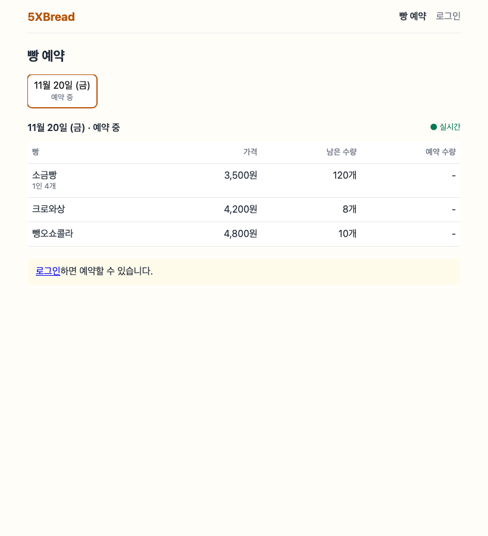
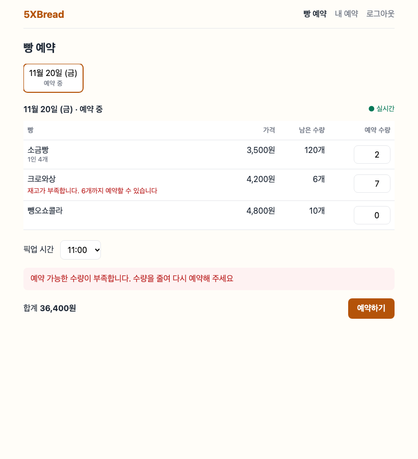
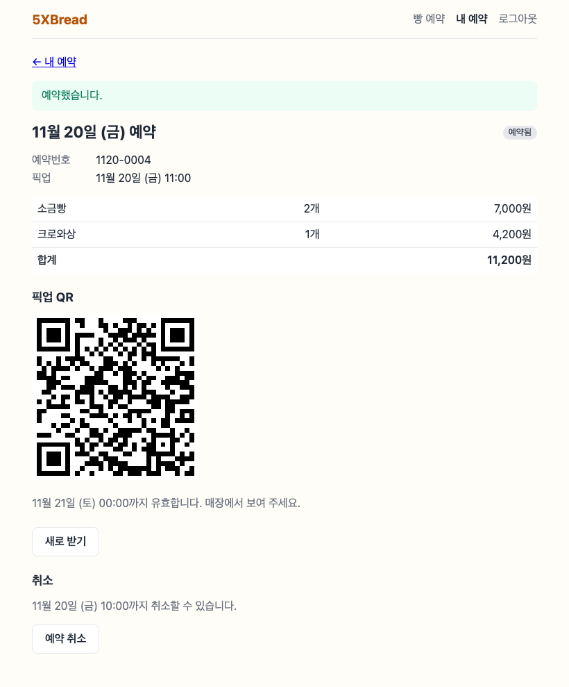
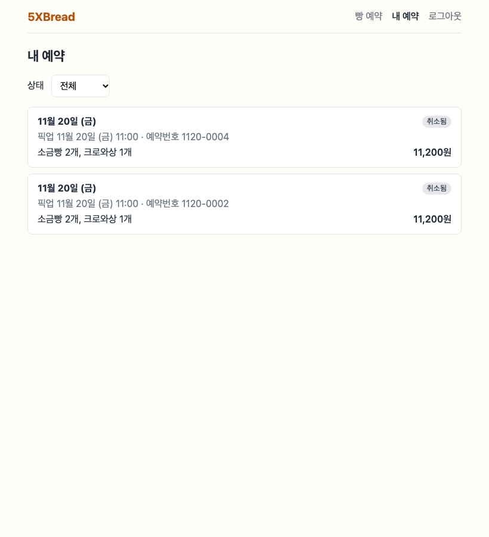
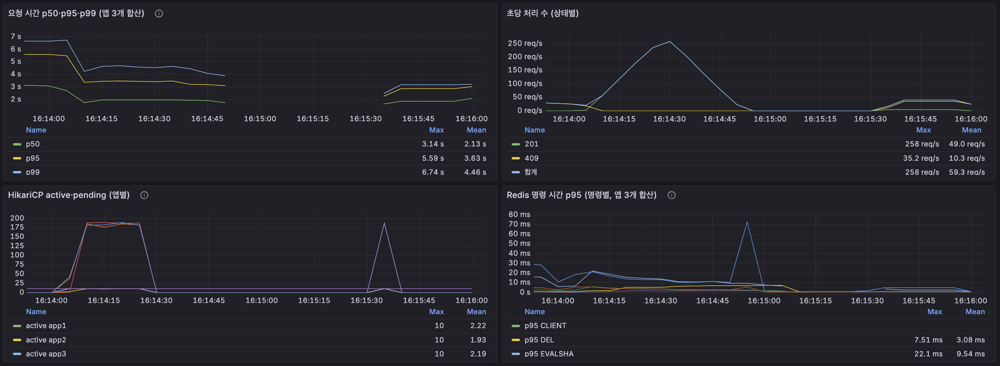
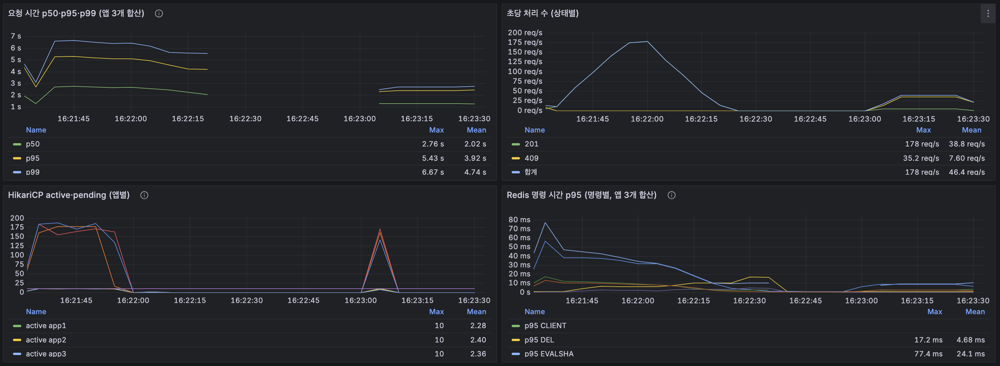

# 5XBread

동네 빵집의 빵을 판매일·픽업 시간대별로 미리 예약하는 서비스의 백엔드와 손님 화면(최소 버전, `frontend/`)입니다. 앱 3개를 동시에 띄운 환경에서도 **초과 예약 0건**을 지키는 것이 핵심입니다.

- 확정한 결정·범위: [`docs/decisions.md`](docs/decisions.md) (정의서와 다르면 이 문서가 우선)
- 엣지 케이스 E-01~E-15와 증명하는 테스트: [`docs/edge-cases.md`](docs/edge-cases.md)

## 스택

Java 21, Spring Boot 3.5.16, Gradle 8.14(Kotlin DSL), MySQL 8, Redis 7, Flyway, Spring Security + JWT, STOMP WebSocket, Caffeine, ShedLock, Nginx, Micrometer + Prometheus·Grafana, Testcontainers, k6(부하 확인), GitHub Actions

화면: React 19 + TypeScript + Vite, TanStack Query, React Router, @stomp/stompjs, CSS Modules, Vitest. API 타입은 springdoc 명세에서 openapi-typescript로 생성

## 구조

```
                         ┌──── Nginx :80 (손님 화면 정적 파일 + /api 라운드 로빈, /ws 업그레이드) ────┐
                         ▼                          ▼                          ▼
                       app1                       app2                       app3     (같은 이미지, 상태 없음)
                         │  Caffeine 30초 (판매일 설정·카탈로그)                    │
          ┌──────────────┴──────────────────────────┬───────────────────────────────┘
          ▼                                         ▼
   Redis 7 (AOF)                              MySQL 8 (KST)
   · 재고·1인 누적: Lua로 검사+차감 한 번에        · 조건부 UPDATE로 최종 확정
   · Idempotency, 로그인 잠금, Refresh Token     · outbox_event (취소 복구·수량 늘리기)
   · Pub/Sub: 캐시 무효화, 잔여 변경(C-03)        · Flyway V1·V2
   · ShedLock (스케줄 작업은 앱 1개에서만)
```

**예약 한 건의 흐름** (`reservation` 패키지, Controller → Facade → Service → Domain → Repository)

1. Redis Lua 한 번으로 모든 빵의 잔여·1인 한도를 검사하고 전부 통과하면 함께 차감 (하나라도 부족하면 아무것도 안 바뀜)
2. DB 트랜잭션에서 `reserved_qty + n <= reservable_qty` 조건부 UPDATE와 예약 저장. 트랜잭션 안에서는 Redis를 부르지 않는다
3. DB가 실패하면 1의 차감을 같은 Lua로 되돌린다(보상). 0행이면 409 `OUT_OF_STOCK`
4. 잔여를 바꾼 Lua가 같은 스크립트에서 버전을 올리고 발행 → 앱마다 200ms씩 모아 STOMP로 구독자에게

취소·직권 취소의 재고 복구와 수량 늘리기는 트랜잭셔널 아웃박스로 커밋과 함께 남기고, 5분마다 정합성 점검이 DB와 Redis의 차이를 고칩니다(같은 차이가 연속 2번 보일 때만).

패키지: `common` `auth` `member` `catalog` `saledate` `reservation` `realtime` `admin` `batch`

## 실행

먼저 `cp .env.example .env` 후 필수 값(`DB_PASSWORD`, `DB_ROOT_PASSWORD`, `JWT_SECRET`, `PICKUP_SECRET`, `WITHDRAWN_PHONE_SECRET`, 각 비밀 키는 32바이트 이상)과 사장님 초기 계정을 채웁니다. 선택 값은 `.env.example`의 주석을 보세요.

### 1. 로컬 (앱 1개)

```bash
cd backend && ./gradlew bootRun --args='--spring.profiles.active=local'
```

- `local` 프로필이 루트의 `compose.yaml`로 MySQL·Redis 컨테이너를 띄웁니다(직접 띄우려면 루트에서 `docker compose up -d`).
- Flyway가 테이블과 초기 데이터(빵 25종, 내일부터 판매일 7일치)를 넣고, 사장님 계정이 없으면 `.env` 값으로 만듭니다(첫 로그인 때 비밀번호 변경).
- API `http://localhost:8080/api/v1/...`, API 문서 `http://localhost:8080/swagger-ui.html`, 실시간 잔여 STOMP `ws://localhost:8080/ws`
- 테스트: `cd backend && ./gradlew build` (Testcontainers로 MySQL·Redis를 따로 띄움)

### 2. 앱 3개 + Nginx

```bash
docker compose -f compose.full.yaml up -d --build --wait
# http://localhost (Nginx → app1~3)
docker compose -f compose.full.yaml down        # 데이터까지 지우려면 -v
```

개발용 `compose.yaml`과 프로젝트 이름·볼륨이 달라 함께 띄워도 섞이지 않습니다. MySQL·Redis 포트는 호스트에 열지 않습니다. 앱 1개당 메모리 768MB(힙 75%).

메트릭까지 보려면 `--profile monitoring`을 붙입니다. Prometheus `http://127.0.0.1:9090`, Grafana `http://127.0.0.1:3000`(대시보드 "5XBread 예약 v1/v2": 요청 p50·p95·p99, 초당 처리 수, HikariCP active·pending, Redis 명령 시간, 5xx, "업무 지표" 줄: 아웃박스 미발행·dead, 노쇼 처리, Redis 잔여 보정. 경고 2개: 아웃박스 미발행이 5분 넘게 남음, dead 행이 있음. Grafana Alerting 화면에만 뜸). 앱의 `/actuator/prometheus`는 compose 네트워크 안에서만 열리고 Nginx는 `/actuator`를 404로 막습니다.

```bash
docker compose -f compose.full.yaml --profile monitoring up -d --build --wait
```

### 3. 부하·정합성 확인 (앱 3개를 띄운 뒤, 루트에서)

| 명령 | 하는 일 | 판정 (하나라도 틀리면 exit 1) |
|---|---|---|
| `./load/run.sh` | 테스트 손님 1,000명(`load/seed.sql`)이 재고 120개인 빵을 동시에 1개씩 예약 | 초과 예약 0, DB 예약 수량 = 예약 합, Redis 잔여 = DB 잔여, 201 수 = 예약 수량, 5xx 0 |
| `./load/run.sh --with-cancel` | 같은 예약에 취소와 다시 예약을 섞음 | 위 판정 + 취소 200 = DB 취소 건수, 201 − 취소 = 예약 수량, 아웃박스 미발행 0 |
| `./load/realtime-check.sh` | STOMP 리스너 6개(앱 3개에 나뉨) + 예약 3건 | 모든 리스너가 버전 1·2·3을 순서대로 받고, 마지막 잔여 = Redis = 목록, 다른 앱이 처리한 예약도 받음 |

| `./load/steady.sh --scenario spread\|hot --rate N` | 손님 10,000명(`load/seed-steady.sql`)이 초당 N건을 60초 동안. spread는 판매일 5 × 빵 20종, hot은 한 빵(총량 500)에 몰림 | 판매일·빵마다 예약 수량 = 예약 합 ≤ 총량, Redis 잔여 = DB(v2). 5xx·dropped는 결과로만 |
| `./load/chaos.sh` | spread 초당 20건 × 180초(취소 섞음) 중에 Redis pause 30초 / app2 kill → start / MySQL restart를 하나씩. 모니터링 profile 필요 | 부하가 끝난 뒤 초과 예약 0, Redis = DB(100행), 아웃박스 미발행 0. 응답 코드 분포·회복 시간은 `load/results/chaos-{시각}/summary.md` |
| `./load/compare.sh --rate-spread N --rate-hot M` | 예약 v1(`RESERVATION_MODE=db-only`) ↔ v2를 번갈아 3라운드, 워밍업 1회 버림. 모니터링 profile 필요 | 위 판정. 결과는 `load/results/{시각}/`(k6 summary JSON, Prometheus 값, `summary.md`) |

테스트 손님은 운영 마이그레이션에 넣지 않고 이 스크립트들만 넣습니다(판매일은 `run.sh` 10일 뒤, `steady.sh` 20일 뒤부터 5일).

### 4. 손님 화면 (`frontend/`)

Node 22가 필요합니다(`frontend/.nvmrc`). 화면: 로그인·가입, 판매일 빵 목록 + 실시간 잔여, 예약, 내 예약 목록·상세·취소, 픽업 QR. 사장님 화면은 아직 없습니다.

**개발** (앱 1개를 `bootRun`으로 띄운 뒤)

```bash
cd frontend
npm ci
npm run dev          # http://localhost:5173
npm test             # 단위 테스트 (Vitest)
npm run build        # 타입 검사(tsc) + 빌드 → dist/
```

Vite 개발 서버가 `/api`와 `/ws`를 `localhost:8080`으로 넘깁니다(`vite.config.ts`). 화면과 API가 같은 출처라 CORS와 WebSocket Origin 설정이 필요 없습니다.

**앱 3개 환경**: 위 2번의 `docker compose -f compose.full.yaml up -d --build --wait` 하나로 화면까지 뜹니다. `frontend/Dockerfile`이 Node 컨테이너에서 빌드해 Nginx 이미지에 넣고, Nginx가 `/api/`·`/ws`는 앱 3개로, 나머지는 정적 파일(`try_files ... /index.html`)로 응답합니다. 화면을 고친 뒤에는 `docker compose -f compose.full.yaml up -d --build nginx`. `http://localhost`로 접속해야 합니다: Refresh 쿠키가 `Secure`라 HTTP에서는 `localhost`만 브라우저가 예외로 받아 줍니다. LAN IP 등 다른 주소로 열면 로그인이 새로고침 뒤 유지되지 않습니다.

**API 타입 다시 만들기** (`frontend/src/api/schema.d.ts`)

`schema.d.ts`는 생성물이지만 커밋합니다. 그래야 CI와 Docker 빌드가 백엔드 없이 타입 검사를 할 수 있습니다. 백엔드의 요청·응답(컨트롤러, DTO record, enum)을 바꾼 PR이 머지되면 아래 순서로 다시 만들어 같은 PR(또는 바로 다음 PR)에 넣습니다.

1. 바뀐 백엔드를 띄운다. 이 브랜치를 main 위로 rebase했다면 rebase한 코드로 띄워야 한다
   - 앱 1개: `cd backend && ./gradlew bootRun --args='--spring.profiles.active=local'` → 명세 `http://localhost:8080/v3/api-docs`
   - 또는 앱 3개: `docker compose -f compose.full.yaml up -d --build --wait` → 명세 `http://localhost/v3/api-docs` (`--build`를 빼면 예전 이미지의 명세가 나온다)
2. 생성한다
   ```bash
   cd frontend
   npm run gen:api                                              # 기본: http://localhost:8080/v3/api-docs
   OPENAPI_URL=http://localhost/v3/api-docs npm run gen:api     # 앱 3개 환경에서
   ```
3. 확인한다: `git diff src/api/schema.d.ts`로 바뀐 부분을 보고 `npm run build && npm test`. 응답 필드가 없어지거나 이름이 바뀌었으면 tsc가 쓰는 곳을 알려 준다
4. 새로 null이 될 수 있는 응답 필드가 생겼으면 `src/api/types.ts`에 `| null`로 고쳐 적는다. springdoc은 응답 record 필드에 required를 붙이지 않아서, 생성할 때 `--properties-required-by-default`로 모두 필수로 만들고 null이 오는 필드만 직접 고친다(그 파일 위쪽 주석)

**스크린샷**

| 화면 | |
|---|---|
| 빵 목록 + 실시간 잔여 (비로그인) |  |
| 예약 실패: 빵별 재고 부족 (409 `errors[]`) |  |
| 예약 상세 + 픽업 QR + 취소 마감 안내 |  |
| 내 예약 목록 |  |

## 측정값 (1차 마무리, 2026-11-16, main `3849e0b`)

환경: Mac(Intel i7-9750H 6코어 12스레드, 메모리 32GB), macOS 26.7, Docker Desktop(VM 12 CPU, 8GB). 앱 3개는 각 768MB, MySQL·Redis·Nginx·k6가 같은 머신에서 함께 돕니다. 첫 실행(워밍업)을 버리고 측정했습니다.

| 시나리오 | 결과 | 응답 시간 |
|---|---|---|
| `run.sh` 동시 예약 1,000건 | 201 **120** / 409 880 / 5xx **0**, 초과 예약 0, Redis = DB. 앱별 336 · 333 · 331건 | 예약 중앙값 2.69s, p95 3.40s / 로그인 p95 8.24s |
| `run.sh --with-cancel` | 201 138 / 409 862, 취소 200 71건, 다시 예약 201 53건 → 최종 예약 120 = 재고, 5xx 0, 아웃박스 미발행 0 | 예약 중앙값 2.31s, p95 5.23s |
| `realtime-check.sh` | 리스너 6개 모두 101·오류 0, 버전 1·2·3, 잔여 117 = Redis, 예약을 처리한 앱 3개 전부에서 전파 | |

응답 시간은 노트북 한 대에서 1,000명이 같은 순간에 로그인(BCrypt)과 예약을 몰아 보낸 값이라 처리량 지표가 아닙니다. 이 측정이 보이는 것은 정합성입니다. 로그인이 느린 이유와 BCrypt 동시 계산 제한은 decisions.md 6장 "재시작 직후 로그인 폭주"에 있습니다.

## 예약 v1/v2 비교 (2026-11-16)

v1은 **재고·한도 검사를 DB로** 하는 방식(`RESERVATION_MODE=db-only`, 측정 전용)입니다. 요청 제한·Idempotency·예약번호는 v2와 같이 Redis를 씁니다. v2는 지금 구조(Redis Lua → DB 조건부 UPDATE)입니다. `./load/compare.sh --rate-spread 500 --rate-hot 150`, 3라운드 중앙값(최소~최대). 환경은 위와 같고 Prometheus·Grafana가 함께 돕니다.

| 시나리오 | 모드 | 중앙값 | p95 | 처리량 | 5xx | Hikari pending 최대 |
|---|---|---|---|---|---|---|
| 동시 1,000건 (총량 120) | v1 | 2.69s (2.63~2.88) | 3.89s (3.78~4.11) | 237/s (230~255) | 0 | 189 |
| | v2 | 2.15s (2.11~2.26) | 2.76s (2.70~2.83) | 337/s (336~357) | 0 | 188 |
| 일정 부하 spread 500/s × 60s | v1 | 2.61s (2.48~2.69) | 3.79s (3.51~3.95) | 376/s (361~395) | 0 | 190 |
| | v2 | 2.79s (2.30~2.89) | 4.49s (3.47~4.62) | 347/s (335~433) | 0 | 190 |
| 일정 부하 hot 150/s × 60s | v1 | 11ms | 88ms (50~431) | 150/s | 0 | 18 |
| | v2 | 9ms (8~10) | 462ms (44~649) | 150/s | 0 | 32 |

- 처리량: 동시 1,000건은 1,000 ÷ 가장 늦은 응답, 일정 부하는 201·409 응답 수 ÷ 60초. spread 500/s에서는 두 모드 모두 다 보내지 못했다(보내지 못한 요청 3라운드 합 v1 22,053 · v2 23,135)
- 모든 측정에서 초과 예약 0
- **v2가 나은 곳은 동시 1,000건뿐**입니다(p95 −29%, 처리량 +42%). 매진으로 끝나는 요청을 Redis에서 끊어 DB 쓰기를 줄이기 때문입니다. 모든 요청이 성공하는 spread에서는 v2가 오히려 조금 느렸고(범위가 겹침), hot 150/s에서는 둘 다 버텼습니다. 업무 규칙 검사가 Redis 앞에서 요청마다 DB를 읽어 두 방식 모두 Hikari 풀(앱당 10)이 먼저 찹니다
- N을 정한 방법, 측정별 값, 측정의 한계: [`docs/measurements/2026-11-16-reservation-v1-v2.md`](docs/measurements/2026-11-16-reservation-v1-v2.md), 해석: decisions.md 6장 "예약 v1/v2 비교"

| v1 (재고·한도 검사를 DB로) | v2 (Redis Lua) |
|---|---|
|  |  |

## 장애 실험 (2026-11-17)

`./load/chaos.sh`. 앱 3개에 초당 20건(예약 + 앞서 만든 예약의 취소 20%)을 180초 동안 보내며 30초 뒤에 장애를 하나 넣었습니다. 환경은 위와 같고 실험마다 1회입니다.

| 장애 | 손님이 받은 응답 | 회복 | 끝난 뒤 정합성 |
|---|---|---|---|
| Redis 응답 없음 30초 (`docker pause`) | 예약 503 555건(각 약 2초), 취소는 모두 200(약 4초) | unpause 직후 오류 0. 장애 중 쌓인 아웃박스 93행은 최대 57초 뒤 모두 발행 | 초과 예약 0, Redis = DB, 미발행 0, dead 0 |
| 앱 1개 다운 (`kill app2` → 20초 뒤 `start`) | 5xx **0**. 연결 실패 37건은 Nginx가 다른 앱으로 넘김(최대 2초) | app2는 start 18초 뒤부터 다시 요청을 받음 | 초과 예약 0, Redis = DB, 미발행 0, dead 0 |
| MySQL 재시작 (`restart`) | 재시작 순간 약 1초 동안 503 30건, 그 뒤 약 3초는 기다렸다가 성공(최대 4.3초) | restart가 끝나기 전에 오류 0 | 초과 예약 0, Redis = DB, 미발행 0, dead 0 |

- 실험에서 찾아 고친 것: MySQL 연결 장애가 500 `INTERNAL_ERROR`로 나가던 것을 Redis 장애와 같은 503으로 바꿨습니다
- 응답만 멈춘 Redis(`pause`)는 클라이언트에서 시간 초과로 끝난 명령을 재개 뒤 그대로 실행합니다. 아웃박스는 멱등이라 영향이 없습니다. 같은 일로 Idempotency 처리 중 표시가 남아 같은 키가 24시간 409가 될 수 있던 것은 표시를 2분만 두도록 고쳤습니다(decisions.md 6장 "Idempotency 처리 중 TTL")
- 아웃박스는 처리 실패를 `attempts`로 세고 10번째에 dead로 표시해 더 집지 않습니다. 그 재고는 N-05 정합성 점검이 맞춥니다(decisions.md 6장 "아웃박스 실패 한도")
- 방법·초별 값·예상과 달랐던 것: [`docs/measurements/2026-11-17-chaos.md`](docs/measurements/2026-11-17-chaos.md)

## 1차 범위

decisions.md 4장이 기준입니다. 요약:

- **손님**: 가입·로그인(JWT + Refresh rotation, 실패 잠금), 판매일·빵 목록(Redis 잔여 + Caffeine), 예약(Idempotency-Key, 요청 제한), 내 예약 목록(커서)·상세, 취소, 픽업 QR 토큰(HMAC), 비밀번호 변경, 실시간 잔여(STOMP, 서버만)
- **사장님**: 빵 등록·수정·판매 중지, 판매일·픽업 시간대 설정, 수량 설정(ETag/If-Match), 수령 처리·검색·QR 검증, 직권 취소, 임시 비밀번호, 예약 제한 해제, 수량 재계산
- **배치·복구**: 노쇼 처리(매일 21:00), 트랜잭셔널 아웃박스, 정합성 점검(5분), 모두 ShedLock으로 앱 1개에서만
- **테스트**: 동시 요청 테스트 포함 JUnit + Testcontainers, E-01~E-15, 시간대 고정 테스트, 앱 3개 스크립트 3종

## 2차로 미룬 것

사장님 화면 전체, 손님 화면 나머지(C-08 빵 상세, C-10 비밀번호 변경, C-11 예약 제한 안내, C-05 예정·지난 예약 탭), A-03 수량 복사, A-05 대시보드 실시간·픽업 준비 목록 인쇄, A-11 판매 통계, 탈퇴, 사진 WEBP 변환, 오래된 데이터 아카이브. (대시보드 경고·업무 지표, 아웃박스 dead letter, 장애 실험은 2차에서 완료) 전체 목록과 근거는 decisions.md 4장 "2차로 미룸"에 있습니다.
