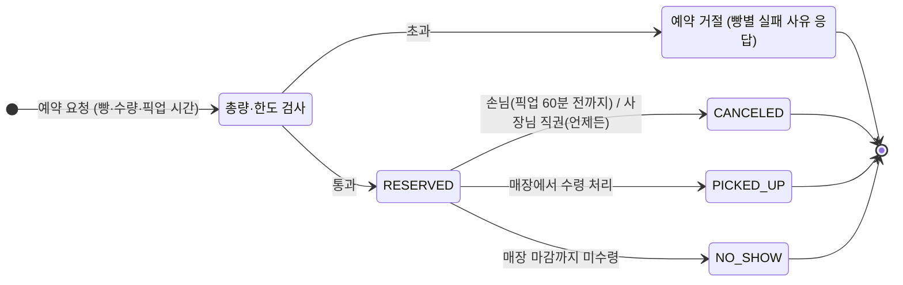
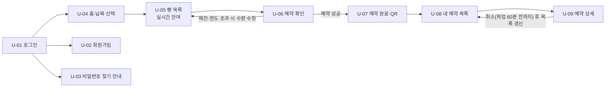
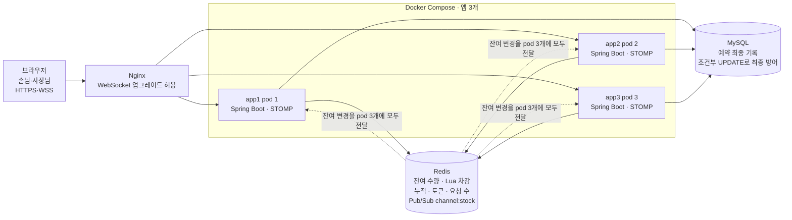
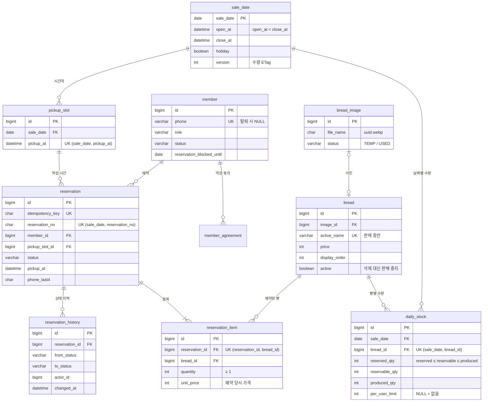

# 5XBread 요구사항 정의서

> 이 문서는 5XBread 1차 개발의 요구사항입니다. 버전·정책 확정값처럼 이 문서와 다르게 결정한 사항은 [decisions.md](./decisions.md)가 우선합니다.

## 목차

1. 개요
2. 액터와 용어
3. 핵심 예약 규칙
4. 기능 요구사항
5. 인증·회원 요건
6. 화면 정의
7. 비기능 요구사항
8. 기술 스택·아키텍처
9. 데이터 모델
10. REST API 명세
11. 예외·엣지 케이스
12. 열린 질문
13. 개발 구조와 DB 설계
- 부록 A. 판매 빵 목록과 수량
- 부록 B. 운영 설정값

---

## 1. 개요

5XBread는 손님이 원하는 빵을 원하는 수량만큼 미리 예약하고 정해진 픽업 시간에 찾아가는 서비스입니다. 빵마다 예약 가능한 총량과 1인당 한도를 두어, 예약 손님과 현장 손님 모두에게 빵이 돌아가게 합니다.

**배경**: 빵집에는 20~30종의 빵이 있고, 종류마다 하루 생산량(N개)이 다릅니다. 인기가 많아 오픈 직후 매진이 반복되고, 줄 서기와 헛걸음 민원이 생깁니다.

### 목표

- 손님이 방문 전에 원하는 빵을 확보할 수 있다
- 사장님이 빵별로 예약 몫과 현장 판매 몫을 나눌 수 있다
- 동시에 예약이 몰려도 준비된 수량보다 많이 예약되지 않는다 (초과 예약 0건)
- 남은 예약 수량을 손님 화면에 실시간으로 보여준다

### 범위 (1차)

- **손님**: 회원가입/로그인(휴대폰 번호 + 비밀번호, 소셜 로그인 없음), 빵 목록·잔여 수량 조회, 여러 빵을 한 번에 예약, 예약 조회, 예약 취소
- **사장님**: 빵 등록·수정, 날짜별 생산량·예약 가능 수량·1인당 한도 설정, 픽업 시간대 설정, 예약 현황 조회, 픽업 완료 처리

### 범위 밖 (1차)

- 소셜 로그인 (카카오·네이버·구글·애플 등 OAuth 전부 미지원)
- 온라인 결제와 환불 (현장 결제 가정)
- 여러 매장 지원
- 알림톡·푸시 알림 (SMS 인증을 포함해 외부 발송은 전부 없음)
- 배달

**개발 환경 가정**: 로컬 PC 한 대에서 `docker compose up` 한 번으로 MySQL, Redis, 앱 3개(pod 3개 역할), Nginx(로드밸런서)가 모두 뜨고 서비스 전체가 동작해야 합니다. SMS, 클라우드, CDN 같은 외부 유료 서비스는 쓰지 않습니다. 빵 사진은 로컬 폴더에 저장하고 앱이 직접 내려줍니다. 실제 서버 배포(Kubernetes 등)는 선택 사항이며, 로컬 구성은 13장에 있습니다.

---

## 2. 액터와 용어

| 용어 | 정의 | 예시 |
|---|---|---|
| 손님 (Customer) | 빵을 예약하고 픽업하는 회원 | |
| 사장님 (Admin) | 빵과 수량을 등록하고 예약을 관리하는 관리자 | |
| 빵 (Bread) | 판매하는 빵 종류. 20~30종 | 소금빵, 크로와상 |
| 판매일 (Sale Date) | 예약 대상이 되는 날짜. 수량은 날짜마다 따로 관리 | 2026-10-10 |
| 생산량 (N) | 해당 판매일에 만드는 그 빵의 총개수 | 소금빵 50개 |
| 예약 가능 총량 | 생산량 중 예약으로 팔 수 있는 최대 수량. 나머지는 현장 판매 | 50개 중 30개 |
| 1인당 한도 | 한 손님이 한 판매일에 그 빵을 예약할 수 있는 최대 수량 | 1인 3개 |
| 잔여 수량 | 예약 가능 총량 − 이미 예약된 수량 | 30 − 27 = 3개 |
| 픽업 시간대 (Pickup Slot) | 사장님이 열어둔 수령 시각 | 11:00, 13:00, 15:00 |
| 예약 (Reservation) | 한 번의 예약 요청. 판매일 1개, 픽업 시간대 1개, 빵 여러 종류를 포함 | |
| 예약 항목 (Reservation Item) | 예약 안의 빵 한 종류와 수량 | 소금빵 2개 |

---

## 3. 핵심 예약 규칙

수량 규칙은 두 개의 한도(빵별 총량, 1인당 한도)를 동시에 지키고, 취소는 픽업 시각 60분 전까지만 허용하는 것이 핵심입니다. 모든 시각은 서버 시각(KST) 기준입니다.

### 수량 규칙

| ID | 규칙 | 예시 |
|---|---|---|
| R-01 | 예약 가능 총량 ≤ 생산량 | 생산 50개면 총량은 최대 50개 |
| R-02 | 판매일·빵별로, 취소되지 않은 예약 수량의 합 ≤ 예약 가능 총량 | 총량 30개, 28개 예약됨 → 3개 요청은 거절 |
| R-03 | 한 손님이 한 판매일에 같은 빵을 예약한 수량의 합 ≤ 1인당 한도. 여러 번 나눠 예약해도 합산 | 한도 3개, 오전에 2개 예약 → 오후에 2개 요청 거절 |
| R-04 | 1인당 한도는 선택 값. 비워두면 총량만 적용 | 식빵은 한도 없음 |
| R-05 | 예약 항목 수량은 1 이상 정수 | 0개·음수 거절 |
| R-06 | 한 예약에 여러 빵을 담으면 전부 성공하거나 전부 실패 (all-or-nothing) | 소금빵 2 + 크로와상 1 중 크로와상이 매진이면 예약 전체 실패, 어떤 빵이 부족한지 응답 |
| R-07 | 사장님은 예약 가능 총량을 이미 예약된 수량보다 작게 줄일 수 없음 | 25개 예약됨 → 총량을 20으로 변경 불가 |

### 시간 규칙

| ID | 규칙 | 예시 |
|---|---|---|
| R-11 | 예약은 판매일별 예약 오픈 시각부터 마감 시각까지만 가능. 두 시각은 사장님이 설정 | 오픈 D-3 10:00, 마감 D-1 20:00 (제안값) |
| R-12 | 예약 시 판매일의 픽업 시간대 1개를 고름 | 10월 10일 11:00 |
| R-13 | 취소는 현재 시각 ≤ 픽업 시각 − 60분일 때만 가능 | 픽업 11:00 → 10:00:00까지 취소 가능, 10:00:01부터 불가 |
| R-14 | 취소는 예약 전체 단위. 일부 빵만 빼려면 취소 후 다시 예약 (1차) | |
| R-15 | 취소된 수량은 즉시 잔여 수량으로 복구되고 다른 손님 화면에 반영 | |
| R-16 | 픽업 시간대 종료 후 매장 마감까지 수령하지 않으면 노쇼로 처리. 제재는 R-17 | |
| R-17 | 최근 30일 안에 노쇼 2회면 그날부터 14일간 새 예약 불가. 이미 한 예약은 유지. 사장님이 해제 가능(A-10) | 10/1, 10/8 노쇼 → 10/22까지 예약 제한 |

**예약 상태**: `RESERVED`(예약됨) → `CANCELED`(취소) / `PICKED_UP`(수령 완료) / `NO_SHOW`(노쇼). 끝 상태 3개에서는 다른 상태로 바뀔 수 없습니다.



수량·한도 검사를 통과한 요청만 예약됨이 되고, 예약됨은 취소·수령·노쇼 중 하나로만 끝납니다. 세 끝 상태는 되돌릴 수 없습니다.

---

## 4. 기능 요구사항

우선순위는 P0(없으면 서비스 불가), P1(1차에 포함), P2(다음 단계)입니다.

### 손님

| ID | 기능 | 상세 | 우선순위 |
|---|---|---|---|
| C-01 | 회원가입·로그인·로그아웃 | 휴대폰 번호 + 비밀번호로 직접 가입. SMS 인증·소셜 로그인(OAuth) 없음. 상세는 5장 | P0 |
| C-02 | 판매일별 빵 목록 조회 | 빵 이름, 가격, 사진, 잔여 수량, 1인당 한도, 내가 이미 예약한 수량. 잔여 0이면 "예약 마감" 표시 | P0 |
| C-03 | 잔여 수량 실시간 갱신 | 목록을 보는 동안 다른 손님의 예약·취소가 새로고침 없이 반영 (WebSocket) | P1 |
| C-04 | 예약하기 | 판매일, 픽업 시간대, 빵별 수량을 한 번에 제출. R-02~R-06, R-11, R-17 검증. 실패 시 빵별 실패 사유 응답 | P0 |
| C-05 | 내 예약 목록·상세 | 상태, 픽업 시각, 빵별 수량, 총 금액, 취소 가능 마감 시각 | P0 |
| C-06 | 예약 취소 | R-13 검증. 취소 마감이 지났으면 버튼 비활성 + 서버에서도 거절 | P0 |
| C-07 | 픽업 확인 화면 | 매장에서 보여줄 예약번호(예: 1010-0427)를 크게, QR을 함께 표시 | P1 |
| C-08 | 빵 상세 보기 | 큰 사진, 설명, 알레르기 성분, 가격. 여기서도 수량 선택 | P1 |
| C-09 | 비밀번호 찾기 안내 | 본인 확인 수단이 없으므로 매장에 요청 → 사장님이 임시 비밀번호 발급(A-09) → 첫 로그인 때 변경 강제 | P1 |
| C-10 | 내 정보·비밀번호 변경·탈퇴 | 이름 수정, 현재 비밀번호 확인 후 변경. 진행 중(`RESERVED`) 예약이 있으면 탈퇴 불가 | P1 |
| C-11 | 예약 제한 안내 | 노쇼로 예약이 제한된 경우(R-17) 홈·예약 화면에 사유와 풀리는 날짜 표시 | P1 |

**뺀 기능: 예약 변경(수량·픽업 시각).** 취소 후 다시 예약하면 같은 결과이고, 변경 기능은 "일부 빵만 늘리기" 같은 경우의 수가 많아 구현 비용에 비해 얻는 것이 적습니다.

### 사장님

| ID | 기능 | 상세 | 우선순위 |
|---|---|---|---|
| A-01 | 빵 등록·수정·판매 중지 | 이름, 가격, 사진, 설명, 알레르기, 노출 순서. 삭제 대신 판매 중지(과거 예약 보존) | P0 |
| A-02 | 판매일별 수량 설정 | 빵마다 생산량, 예약 가능 총량, 1인당 한도 입력. R-01, R-07 검증 | P0 |
| A-03 | 수량 복사 | 전일·지난주 같은 요일 설정을 불러와 표에 채움 (20~30종을 매일 입력하는 부담 감소) | P1 |
| A-04 | 판매일 설정 | 예약 오픈·마감 시각, 픽업 시간대 목록, 휴무일 지정 | P0 |
| A-05 | 예약 현황 대시보드·픽업 준비 목록 | 빵별 예약 수량 / 총량(실시간), 픽업 시간대별 포장 목록과 인쇄 | P0 |
| A-06 | 수령 처리 | 예약번호·번호 뒷 4자리 검색 또는 QR 스캔 후 `PICKED_UP` 처리 | P0 |
| A-07 | 노쇼 자동 처리 | 매장 마감 후 미수령 예약을 `NO_SHOW`로 바꾸고 R-17 예약 제한 적용 (스케줄러) | P1 |
| A-08 | 사장님 직권 취소 | 재료 문제 등으로 매장이 예약을 취소. 취소 마감 제한 없음, 사유 필수 | P1 |
| A-09 | 임시 비밀번호 발급 | 번호로 회원을 찾아 임시 비밀번호 발급(화면에 1번만 표시). 발급 이력 기록 | P1 |
| A-10 | 회원 관리 | 번호 뒷 4자리·이름 검색, 회원별 예약·노쇼 이력, 예약 제한 해제 | P1 |
| A-11 | 판매 통계 | 기간·빵별 예약률(예약/총량), 매진까지 걸린 시간, 취소율, 노쇼율. 다음 주 수량을 정하는 근거 | P1 |
| A-12 | 수량 재계산 | Redis 잔여를 DB 기준으로 다시 맞추는 버튼(장애 복구용). 결과로 고친 빵과 차이를 보여줌 | P1 |

### 규모 가정

**규모 가정** (용량 산정의 기준, 부하 테스트로 검증)

| 항목 | 평상시 | 오픈 직후 1분 | 설계 목표 (10배 여유) |
|---|---|---|---|
| 동시 접속 (WebSocket 연결) | 200 | 5,000 | 50,000 (pod당 약 17,000) |
| 빵 목록 조회 | 초당 10건 | 초당 2,000건 | 초당 20,000건 |
| 예약 요청 | 분당 5건 | 초당 500건 | 초당 5,000건 |
| 하루 예약 건수 | 400건 | | |
| 1년 누적 데이터 | 예약 약 15만 건, 예약 항목 약 45만 건, 이력 약 40만 건 | | |

하루 예약 가능 수량이 924개(부록 A)라, 5,000명이 몰려도 성공하는 요청은 수백 건이고 나머지는 거절됩니다. 그래서 이 서비스의 핵심은 **"실패할 요청을 얼마나 빨리, 싸게 거절하는가"**입니다.

---

## 5. 인증·회원 요건

로그인은 휴대폰 번호와 비밀번호로만 합니다. SMS 인증과 소셜 로그인(OAuth)은 넣지 않아, 외부 서비스 없이 로컬에서 전부 동작합니다. 대신 번호가 진짜 본인 것인지는 확인하지 않으므로, 1인 한도(R-03)는 "계정 1개" 기준이고 다중 계정은 픽업 때 이름·번호 확인과 IP당 가입 제한으로만 견제합니다(Q-12).

### 계정 정책

| ID | 요건 | 상세 |
|---|---|---|
| AU-01 | 로그인 아이디 = 휴대폰 번호 | `010`으로 시작하는 11자리. 하이픈을 빼고 저장. 번호 1개당 계정 1개 |
| AU-02 | 가입 요청 제한 | 같은 IP에서 가입은 하루 10회까지(Redis 카운터). 번호 소유 확인은 하지 않음(Q-12) |
| AU-03 | 비밀번호 규칙 | 8~64자, 영문과 숫자 각각 1자 이상. 휴대폰 번호와 같거나 포함하면 거절 |
| AU-04 | 비밀번호 저장 | BCrypt(cost 10) 해시만 저장. 원문은 로그·DB 어디에도 남기지 않음 |
| AU-05 | 로그인 실패 잠금 | 연속 5회 실패 시 10분 잠금. 성공하면 횟수 초기화. 실패 메시지는 "번호 또는 비밀번호가 틀렸습니다"로 통일(가입 여부 노출 금지) |
| AU-06 | 비밀번호 재설정 | 사장님이 임시 비밀번호(무작위 12자)를 발급해 화면에 한 번만 표시. 첫 로그인 때 변경 강제. 발급 즉시 모든 리프레시 토큰 폐기 |
| AU-07 | 탈퇴 | `RESERVED` 예약이 없을 때만. 이름·번호는 마스킹하고 예약 기록은 통계용으로 보존. 같은 번호로 재가입은 30일 후 |
| AU-08 | 사장님 계정 | 가입 화면 없음. 배포 시 초기 데이터로 `ADMIN` 계정 생성, 첫 로그인 때 비밀번호 변경 강제 |
| AU-09 | 권한 | `/api/admin/**`는 `ADMIN`만. 손님은 본인 예약만 조회·취소 |
| AU-10 | 개인정보 표시 | 사장님 화면에는 이름 + 번호 뒷 4자리만(010-\*\*\*\*-1234). 로그에도 마스킹 |

### 토큰 방식

pod가 3개이므로 서버 메모리 세션은 쓸 수 없고, 어느 pod에서나 검증되는 JWT를 씁니다.

| 구분 | 수명 | 전달 | 저장 |
|---|---|---|---|
| Access Token (JWT) | 30분 | `Authorization: Bearer` 헤더, WebSocket은 STOMP CONNECT 헤더 | 서버 저장 없음 (서명만 검증) |
| Refresh Token | 14일 | HttpOnly·Secure·SameSite=Strict 쿠키 | Redis `refresh:{memberId}:{tokenId}`, 사용할 때마다 새 토큰으로 교체(rotation) |

- 로그아웃: 해당 리프레시 토큰 삭제. 이미 발급된 Access Token은 최대 30분 유효(허용)
- 이미 사용한 리프레시 토큰이 다시 오면 탈취로 보고 그 회원의 토큰 전부 폐기

### 인증 API

로그인·인증도 동사(login, verify) 대신 "무엇을 만들고 없애는가"로 표현합니다. 로그인은 토큰 자원을 만드는 것, 로그아웃은 그 토큰을 없애는 것입니다. 전체 원칙은 10장을 따릅니다.

| 자원 | 메서드 | 경로 | 요청 | 성공 응답 | 주요 실패 |
|---|---|---|---|---|---|
| 회원 | POST | `/api/v1/members` | `{phone, password, name, agreements}` | 201 + `Location: /api/v1/members/{id}` | 409 이미 가입한 번호, 429 IP당 가입 한도 |
| 로그인 토큰 | POST | `/api/v1/auth/tokens` | `{phone, password}` | 201 `{accessToken, expiresIn, mustChangePassword}` + Refresh 쿠키 | 401 번호·비밀번호 불일치, 423 잠김 |
| 로그인 토큰 재발급 | PUT | `/api/v1/auth/tokens/current` | Refresh 쿠키 | 200 새 Access Token + 새 Refresh 쿠키 | 401 만료·재사용 감지 |
| 로그아웃 | DELETE | `/api/v1/auth/tokens/current` | Refresh 쿠키 | 204 | |
| 내 정보 | GET | `/api/v1/members/me` | | 200 | 401 |
| 내 정보 수정 | PATCH | `/api/v1/members/me` | `{name}` | 200 | 400 |
| 내 비밀번호 | PUT | `/api/v1/members/me/password` | `{currentPassword, newPassword}` | 204 | 422 현재 비밀번호 불일치·규칙 위반 |
| 탈퇴 | DELETE | `/api/v1/members/me` | | 204 | 409 진행 중인 예약 있음 |
| 회원 검색 (사장님) | GET | `/api/v1/admin/members?phone=` | | 200 (번호는 뒷 4자리만 표시) | 403 |
| 임시 비밀번호 (사장님) | POST | `/api/v1/admin/members/{memberId}/temporary-passwords` | | 201 `{temporaryPassword}` (이 응답에서만 노출) | 404 |

`/members/me`는 "현재 로그인한 회원"을 가리키는 별칭입니다. 회원 ID를 URL에 넣지 않아 다른 회원 ID를 넣어 보는 시도(IDOR)를 원천적으로 막습니다.

**인증용 Redis 키** (pod 3개가 같은 상태를 보도록 메모리 대신 Redis에 둠)

| 키 | TTL | 용도 |
|---|---|---|
| `login:fail:{phone}` | 10분 | 로그인 실패 횟수·잠금 |
| `signup:ip:{ip}:{yyyyMMdd}` | 자정까지 | IP당 가입 횟수 |
| `refresh:{memberId}:{tokenId}` | 14일 | 리프레시 토큰 |
| `refresh:index:{memberId}` | 14일 | 그 회원의 토큰 ID 목록(한 번에 폐기할 때 사용) |

---

## 6. 화면 정의

손님 화면 11개는 모바일 웹 기준, 사장님 화면 11개는 매장 태블릿·PC 기준입니다. 사장님 화면은 `/admin` 아래에 두고 `ADMIN`만 들어갈 수 있습니다.

### 디자인 가이드

톤은 "갓 구운 빵집"의 따뜻한 갈색과 크림색입니다. 손님 화면은 모바일 우선(폭 360~430px), 사장님 화면은 태블릿·PC(폭 1024px 이상)입니다. 가장 중요한 원칙은 **"남은 수량·매진·취소 마감을 한눈에"**입니다.

| 구분 | 이름 | 값 | 쓰는 곳 |
|---|---|---|---|
| 색 | Primary (크러스트 브라운) | `#8B5A2B` | 주요 버튼, 선택된 날짜·시간, 로고 |
| 색 | Accent (버터 옐로) | `#F2C14E` | 하단 요약 바, 강조 배지 |
| 색 | Background (크림) | `#FFF8EE` | 화면 배경 |
| 색 | Surface | `#FFFFFF` | 카드, 표 |
| 색 | Text / Text-sub | `#2B2118` / `#7A6A5C` | 본문 / 보조 글자(가격, 안내) |
| 색 | Border | `#E8DCCB` | 카드 테두리, 구분선 |
| 상태 색 | Good / Warning / Danger / Disabled | `#2E7D32` / `#E07B00` / `#C62828` / `#B8ADA2` | 10개 이상 남음 / 1~9개 남음 / 매진·오류·취소 / 마감·비활성 |
| 글꼴 | Pretendard (웹폰트, 로컬 파일로 포함) | 12 / 14 / 16 / 20 / 24px | 보조 / 본문 / 강조 본문 / 화면 제목 / 예약번호 |
| 간격 | 4px 배수 | 4, 8, 12, 16, 24, 32 | 화면 좌우 여백 16, 카드 사이 8 |
| 모서리 | radius | 카드 12, 버튼 8, 칩·배지 999 | |
| 터치 | 최소 크기 | 44 × 44px, 주요 버튼 높이 52px | 수량 +/−, 하단 버튼 |

### 컴포넌트 규칙

- **수량 배지**: 숫자를 항상 글자로 표시("3개 남음"). 색만으로 상태를 구분하지 않음(색약 사용자)
- **수량 조절(−/+)**: + 버튼은 잔여와 남은 1인 한도 중 작은 값에서 비활성. 누르면 "1인 최대 4개예요" 안내
- **하단 고정 바**: 고른 빵 종류·개수·합계 + 다음 버튼. 고른 게 없으면 숨김
- **확인 창**: 취소·직권 취소·임시 비밀번호 발급처럼 되돌릴 수 없는 동작에만 사용. 위험 버튼은 Danger 색 테두리
- **오류 문구**: "무엇이 + 왜 + 어떻게". 예: "까눌레가 매진됐어요. 수량을 빼고 다시 예약해 주세요". 서버의 에러 코드마다 문구 하나
- **로딩·빈 화면**: 목록은 회색 자리 표시(스켈레톤), 예약이 없으면 "아직 예약이 없어요" + 빵 보러 가기 버튼
- **실시간 변경 표시**: 잔여가 바뀌면 배지를 0.3초 깜박임. 내가 고른 수량이 줄어들면 화면 아래에 안내(토스트)
- **관리자 표**: 규칙을 어긴 칸은 빨간 테두리 + 표 아래에 이유. 저장 전에 바뀐 칸은 배경색으로 표시

### 화면 모양 (와이어프레임 요약)

**손님 화면은 남은 수량과 취소 마감을 항상 보이게 한다.**

- **U-05 빵 목록**: 상단에 날짜 탭(10/9(금), **10/10(토)**, 10/11(일)). 빵 카드마다 사진·이름·가격·남은 수량 배지("3개 남음", "12개 남음", "매진")와 −/+ 수량 조절. 매진 카드는 "예약 마감". 하단 바에 "2종 3개 · 9,800원 · 다음"
- **U-06 예약 확인**: "10/10(토) 픽업", 빵별 수량·금액(소금빵 × 2 = 7,000원, 휘낭시에 × 1 = 2,800원, 합계 9,800원), 픽업 시간 칩(10:00~15:00), 안내 상자 "11:00 픽업은 10:00까지 취소할 수 있어요", 예약하기 버튼
- **U-09 예약 상세**: 상태 배지 "예약됨", 큰 예약번호 `1010-0427`, QR, "매장에서 이 화면을 보여주세요", 픽업 일시·빵·금액(현장 결제), "취소 마감 10:00 · 1시간 12분 남음", 예약 취소 버튼(Danger 테두리)

**관리자 화면은 표와 경고로 입력 실수를 막는다.**

- 상단 메뉴: 대시보드 / 수량 설정 / 수령 처리 / 회원 / 통계
- **수량 설정 · 10/10(토)**: 전일 복사·지난주 복사·저장 버튼, 표(빵 / 생산량 / 예약 가능 / 1인 한도 / 예약됨). 예약된 수량(40)보다 작게 입력한 칸(30)은 빨간 테두리 + "까눌레: 이미 예약된 40개보다 적게 줄일 수 없어요". 다른 사람이 먼저 고쳤으면 새로고침 안내(412)
- **수령 처리**(오른쪽 패널): 예약번호 / 뒷 4자리 / QR 검색창, 결과 카드(1010-0427, 김\*건 · 11:00 픽업, 소금빵 2 · 휘낭시에 1, 9,800원 현장 결제), 수령 완료 버튼, 직권 취소(사유 입력) 링크

**손님 화면 흐름: 로그인 후 화면 4개로 예약이 끝나고, 실패하면 빵 목록으로 돌아간다.**



하단 탭으로 어디서나 이동: 홈(U-04) · 내 예약(U-08) · 마이페이지(U-10). 예약이 실패하면 빵 목록(U-05)으로 돌아가 수량만 고치면 되고, 취소는 예약 상세(U-09)에서만 할 수 있습니다.

### 손님 화면

| ID | 화면 | 구성 요소 | 동작·규칙 | 기능 |
|---|---|---|---|---|
| U-01 | 로그인 | 휴대폰 번호, 비밀번호, 로그인 버튼, 회원가입·비밀번호 찾기 링크 | 소셜 로그인 버튼 없음. 5회 실패 시 "10분 후 다시 시도" 안내 | C-01 |
| U-02 | 회원가입 | 휴대폰 번호, 이름, 비밀번호·비밀번호 확인, 약관 동의(한 화면) | 비밀번호 규칙을 입력 중 실시간 표시. 이미 가입한 번호면 로그인으로 안내 | C-01 |
| U-03 | 비밀번호 재설정 | 매장 전화번호, 안내 문구 | 사장님이 임시 비밀번호 발급(A-09). 그 비밀번호로 로그인하면 변경 화면으로 이동 | C-09 |
| U-04 | 홈 (날짜 선택) | 예약 가능한 판매일 탭(오늘~7일), 날짜별 상태 배지 | 오픈 전이면 "10/7(화) 10:00 오픈"과 카운트다운, 휴무일은 비활성 | C-02 |
| U-05 | 빵 목록 | 빵 카드(사진, 이름, 가격, "3개 남음", "1인 최대 3개", 내가 예약한 수량), 수량 조절(−/+), 하단 요약 바(n종 m개, 합계 금액, 다음) | + 버튼은 잔여와 남은 한도 중 작은 값에서 멈춤. 매진은 회색 + "예약 마감". 잔여는 WebSocket으로 자동 갱신, 선택 수량보다 잔여가 줄면 수량을 줄이고 알림 | C-02, C-03 |
| U-06 | 예약 확인 | 선택한 빵 목록·금액, 픽업 시간대 선택, 취소 규칙 안내("11:00 픽업은 10:00까지 취소 가능"), 예약하기 버튼 | 버튼은 한 번 누르면 비활성. 실패하면 부족한 빵을 표시하고 U-05로 돌아가 수량 수정 | C-04 |
| U-07 | 예약 완료 | 예약번호, 픽업 QR, 픽업 일시, 취소 마감 시각, 내 예약 보기 버튼 | 뒤로 가기로 예약 확인 화면에 돌아가도 재제출되지 않음 | C-04, C-07 |
| U-08 | 내 예약 목록 | "예정" / "지난 예약" 탭, 예약 카드(날짜, 픽업 시각, 빵 요약, 상태 배지) | 예정 탭은 픽업이 가까운 순, 지난 예약은 최신 순 | C-05 |
| U-09 | 예약 상세 | 빵별 수량·금액, 픽업 QR, 취소 마감까지 남은 시간, 취소 버튼 | 취소 전 확인 창. 마감이 지나면 버튼 비활성 + "취소 가능 시간이 지났습니다" | C-05, C-06 |
| U-10 | 마이페이지 | 이름·번호, 비밀번호 변경, 로그아웃, 탈퇴 | 예정된 예약이 있으면 탈퇴 버튼 대신 안내 문구 | C-10 |
| U-11 | 빵 상세 (아래에서 올라오는 창) | 큰 사진, 설명, 알레르기 성분, 가격, 수량 조절 | U-05에서 빵 카드를 누르면 열림. 수량은 U-05와 같은 상태를 공유 | C-08 |

### 사장님 화면

| ID | 화면 | 구성 요소 | 동작·규칙 | 기능 |
|---|---|---|---|---|
| M-01 | 관리자 로그인 | 휴대폰 번호, 비밀번호 | 손님과 같은 로그인 API. `ADMIN`이 아니면 접근 거부. 첫 로그인 때 비밀번호 변경 | AU-08 |
| M-02 | 대시보드 | 날짜 선택, 빵별 예약/총량 막대, 픽업 시간대별 예약 건수, 수령·취소·노쇼 수 | 예약이 들어오면 실시간 갱신 | A-05 |
| M-03 | 빵 목록 | 빵 표(사진, 이름, 가격, 판매 여부, 노출 순서), 등록 버튼 | 끌어서 노출 순서 변경 | A-01 |
| M-04 | 빵 등록·수정 | 이름, 가격, 사진 업로드, 설명, 판매 중지 | 삭제 버튼 없음(판매 중지만) | A-01 |
| M-05 | 판매일 설정 | 달력, 예약 오픈·마감 시각, 픽업 시간대 추가·삭제, 휴무일 | 예약이 있는 픽업 시간대는 삭제 불가 | A-04 |
| M-06 | 수량 설정 | 빵 20~30행 표(생산량, 예약 가능 총량, 1인 한도, 현재 예약 수), 전일·지난주 복사, 일괄 저장 | 규칙 위반 행은 빨간 테두리 + 사유 | A-02, A-03 |
| M-07 | 픽업 준비 목록 | 픽업 시간대별 예약자(이름, 번호 뒷 4자리)와 빵 목록, 인쇄 | 시간대별 빵 합계도 표시(포장용) | A-05 |
| M-08 | 수령 처리 | 검색(예약번호 / 번호 뒷 4자리), QR 스캔, 예약 상세, 수령 완료·직권 취소 버튼 | 직권 취소는 사유 입력 필수 | A-06, A-08 |
| M-09 | 회원 관리 | 검색(번호 뒷 4자리, 이름), 회원 상세(예약·노쇼 이력), 임시 비밀번호 발급, 예약 제한 해제 | 번호는 마스킹. 임시 비밀번호는 창을 닫으면 다시 볼 수 없음 | A-09, A-10 |
| M-10 | 판매 통계 | 기간 선택, 빵별 예약률 막대, 매진 시각 표, 취소·노쇼율 | 기간은 최대 90일. 전날까지의 집계만 표시 | A-11 |
| M-11 | 수량 재계산 | 날짜 선택, 재계산 버튼, 결과 표(빵, Redis 값, DB 기준 값, 보정량) | M-02 대시보드에 불일치 경고가 뜨면 여기로 이동 | A-12 |

---

## 7. 비기능 요구사항

예약 오픈 직후 요청이 몰려도 초과 예약이 0건이어야 하고, 그 상태에서도 응답이 빨라야 합니다. Redis가 빠른 수량 차감을, DB가 최종 기록을 맡습니다.

### 동시성·정합성

| ID | 요구사항 | 구현 방향 |
|---|---|---|
| N-01 | 초과 예약 0건 (R-02) | Redis에 `stock:{판매일}:{빵ID}` 잔여 수량을 두고, Lua 스크립트로 검사와 차감을 한 번에 실행 |
| N-02 | 1인당 한도 초과 0건 (R-03) | `user_qty:{판매일}:{손님ID}` 해시를 같은 Lua 스크립트 안에서 검사·증가. 같은 손님의 동시 요청(두 탭)도 막음 |
| N-03 | 여러 빵 예약의 원자성 (R-06) | Lua 스크립트가 모든 빵을 먼저 검사하고, 하나라도 실패하면 아무것도 차감하지 않음 |
| N-04 | DB가 최종 기준 | Redis 차감 성공 후 DB에 예약 저장. DB 저장 실패 시 Redis 수량 복구(보상) |
| N-05 | Redis·DB 불일치 복구 | 주기적으로 DB 예약 합계와 Redis 잔여를 비교. Redis 재시작 시 DB 기준으로 재적재 |
| N-06 | 중복 제출 방지 | 클라이언트가 `Idempotency-Key` 헤더를 보내고, 같은 키는 처음 결과를 그대로 반환 |
| N-07 | 취소 동시성 | 취소와 수령 처리가 동시에 오면 한쪽만 성공 (상태 조건부 UPDATE 또는 낙관적 락) |

### 실시간 (WebSocket)

| ID | 요구사항 | 구현 방향 |
|---|---|---|
| N-11 | 잔여 수량 변경 푸시 | STOMP 토픽 `/topic/sale-dates/{날짜}/stock`으로 바뀐 빵의 잔여만 전송 |
| N-12 | pod 3개 어디에 연결돼도 전달 | Redis Pub/Sub으로 pod 3개 모두에 이벤트 전파 |
| N-13 | 푸시 폭주 방지 | 수량 변경을 200ms 단위로 묶어 전송 |
| N-14 | 연결 끊김 대비 | 재연결 시 목록 API를 다시 조회해 최신화. WebSocket은 편의 기능이고, 예약 가부는 항상 서버가 판단 |

### 성능·운영 (목표치, 부하 테스트로 검증)

| ID | 요구사항 |
|---|---|
| N-21 | 예약 오픈 직후 동시 예약 요청 1,000건에서 초과 예약 0건 |
| N-22 | 예약 API p95 응답 시간 300ms 이하 (동시 사용자 1,000명) |
| N-23 | 같은 손님의 예약 요청은 초당 5회로 제한 (매크로 방지) |
| N-24 | 모든 시각 비교는 서버 시각(KST). 클라이언트 시각은 신뢰하지 않음 |
| N-25 | 예약·취소·수량 변경은 누가 언제 했는지 이력으로 남김 |
| N-26 | 예약 수, 매진 시각, 실패 사유별 건수를 대시보드로 모니터링 |

---

## 8. 기술 스택·아키텍처

API 서버는 같은 이미지의 pod 3개로 돌고, pod끼리 공유해야 하는 상태(수량, 토큰, 요청 횟수, WebSocket 이벤트)는 모두 Redis나 MySQL에 둡니다. pod 메모리에는 사라져도 되는 것만 둡니다.



스케줄러는 ShedLock으로 pod 1개에서만 실행합니다. 어느 pod가 예약을 처리하든 Redis Pub/Sub을 거쳐 세 pod에 연결된 모든 손님에게 잔여 변경이 전달됩니다.

### 백엔드

| 기술                           | 용도 | 선택 이유 |
|------------------------------|---|---|
| Java 21, Spring Boot 3.5.16        | API 서버 | 지원 중인 최신 LTS·GA 라인, 가상 스레드 사용 가능 |
| Spring Security + JWT(jjwt)  | 자체 로그인, 권한 | OAuth 없이 휴대폰+비밀번호. pod 3개에서 세션 공유 없이 검증 |
| Spring Data JPA (+ QueryDSL) | DB 접근 | 동적 조회(관리자 검색)는 QueryDSL |
| MySQL 8 + Flyway             | 최종 데이터, 스키마 이력 관리 | 트랜잭션·제약 조건으로 마지막 방어선 |
| Redis 7 (Lettuce) + Lua 스크립트 | 잔여 수량 차감, 한도 검사 | 여러 빵을 한 번에 원자적으로 검사·차감 |
| Redis Pub/Sub                | pod 간 이벤트 전파 | pod 3개에 흩어진 WebSocket 연결에 모두 전달 |
| Redisson                     | 빵별 분산 락 (수량 설정 변경 시) | 락 타임아웃·재시도 내장 |
| Spring WebSocket + STOMP     | 실시간 잔여 푸시 | 토픽 구독 모델, 브라우저 클라이언트 풍부 |
| ShedLock (Redis)             | 스케줄러 단일 실행 | 노쇼 처리·정합성 점검이 pod 3개에서 3번 돌지 않게 |
| springdoc-openapi            | API 문서 | Swagger UI 자동 생성 |

### 프론트엔드

| 기술 | 용도 |
|---|---|
| React 18 + TypeScript + Vite | 손님·사장님 웹 (한 앱, `/admin` 라우트 분리) |
| React Router, TanStack Query | 화면 이동, 서버 데이터 캐시·재조회 |
| @stomp/stompjs | WebSocket 연결·재연결 |
| qrcode / html5-qrcode | 픽업 QR 표시, 매장 QR 스캔 |

### 인프라·운영

| 구성 | 로컬 (기본) | 실제 배포 시 (선택) | 비고 |
|---|---|---|---|
| 앱 서버 | Docker Compose `app1`, `app2`, `app3` (같은 이미지, pod 3개 역할) | Kubernetes Deployment replicas 3 | readiness는 Actuator `/actuator/health` |
| 로드밸런서 | Nginx 컨테이너 (라운드 로빈, WebSocket Upgrade 허용, `proxy_read_timeout 3600s`) | NGINX Ingress | sticky session 불필요 |
| DB | `mysql:8.0` 컨테이너 + 볼륨 | 관리형 MySQL | Flyway가 앱 시작 시 스키마·초기 데이터 적용 |
| Redis | `redis:7` 컨테이너 | 관리형 Redis | AOF 켜서 재시작해도 값 유지 |
| 빵 사진 | 로컬 볼륨 `./data/images`, 앱이 `/images/**`로 제공 | 오브젝트 스토리지 | `ImageStorage` 인터페이스로 구현만 교체 |
| 빌드 | Gradle + Dockerfile(멀티 스테이지) | GitHub Actions | |
| 모니터링 | Prometheus + Grafana 컨테이너(선택, `--profile monitoring`) | 동일 | |
| 부하 테스트 | k6 (로컬 설치 또는 컨테이너) | 동일 | Nginx 주소로 호출해 앱 3개에 분산 |

**테스트**: JUnit 5, Mockito, Testcontainers(MySQL·Redis 실제 컨테이너로 통합 테스트), k6(부하 테스트, N-21·N-22 검증). 동시성 테스트는 `ExecutorService`로 요청 1,000개를 동시에 보내 초과 예약 0건을 확인합니다.

### pod 3개라서 따로 처리해야 하는 것

| 항목 | 그냥 두면 생기는 문제 | 처리 방식 |
|---|---|---|
| WebSocket 알림 | 예약을 pod 2가 처리하면 pod 1·3에 연결된 손님은 잔여 변경을 못 받음 | 처리한 pod가 Redis `channel:stock`에 발행, 3개 pod가 모두 구독해 자기 연결에 전달 |
| 로그인 상태 | 메모리 세션이면 다른 pod로 가는 순간 로그아웃 | JWT(서버 저장 없음) + 리프레시 토큰은 Redis |
| 스케줄러 | 노쇼 처리·정합성 점검이 3번 실행 | ShedLock으로 1개 pod만 실행 |
| 요청 제한·로그인 실패 | pod별로 세면 실제로는 3배까지 허용 | 카운터를 Redis에 (`INCR` + TTL) |
| 중복 제출 방지 | 재시도가 다른 pod로 가면 못 걸러냄 | `idem:{key}`를 Redis에 |
| 예약번호 순번 | pod마다 순번을 만들면 충돌 | Redis `INCR seq:{판매일}` |
| 빵 목록 로컬 캐시 | 사장님이 가격을 바꿔도 pod마다 다른 값 | 캐시 TTL 30초 + 변경 시 Pub/Sub으로 무효화 |
| 배포 | 롤링 배포 중 내려가는 pod의 WebSocket이 끊김 | preStop으로 연결 정리 시간 확보, 클라이언트 자동 재연결 후 목록 재조회(N-14). 예약 오픈 시간대에는 배포 금지 |

---

## 9. 데이터 모델

빵 자체(`bread`)와 날짜별 수량(`daily_stock`)을 분리하는 것이 핵심입니다. 같은 소금빵이라도 날짜마다 생산량과 한도가 다르기 때문입니다.

| 테이블 | 주요 컬럼 | 제약·비고 |
|---|---|---|
| `member` | id, name, phone, password_hash, role(CUSTOMER/ADMIN), status(ACTIVE/LOCKED/WITHDRAWN), must_change_password, reservation_blocked_until, last_login_at, created_at, withdrawn_at | phone UNIQUE |
| `bread` | id, name, category, price, image_url, description, allergens, display_order, active, created_at, updated_at | 20~30건. 삭제 대신 active=false |
| `sale_date` | date(PK), open_at, close_at, is_holiday | 예약 오픈·마감 시각 |
| `pickup_slot` | id, sale_date, pickup_at | (sale_date, pickup_at) UNIQUE |
| `daily_stock` | id, sale_date, bread_id, produced_qty, reservable_qty, reserved_qty, per_user_limit(NULL=무제한), version | (sale_date, bread_id) UNIQUE. CHECK reserved_qty ≤ reservable_qty ≤ produced_qty |
| `reservation` | id, reservation_no, member_id, phone_last4, sale_date, pickup_slot_id, pickup_at, status, total_price, created_at, canceled_at, picked_up_at, idempotency_key | idempotency_key UNIQUE. 인덱스 (member_id, sale_date) |
| `reservation_item` | id, reservation_id, bread_id, quantity, unit_price | quantity ≥ 1. unit_price는 예약 당시 가격 스냅샷 |
| `reservation_history` | id, reservation_id, from_status, to_status, actor_id, changed_at | N-25 이력 |
| `daily_sales_stat` | sale_date, bread_id, reservable_qty, reserved_qty, canceled_qty, picked_up_qty, no_show_qty, sold_out_at | PK (sale_date, bread_id). 매일 새벽 배치가 전날 값을 집계(A-11). 통계 화면은 이 표만 읽음 |

### Redis 키

| 키 | 타입 | 용도 |
|---|---|---|
| `stock:{date}:{breadId}` | String(정수) | 잔여 수량 |
| `limit:{date}:{breadId}` | String(정수) | 1인당 한도 캐시 |
| `user_qty:{date}:{memberId}` | Hash(breadId → 수량) | 손님별 누적 예약 수량 |
| `idem:{key}` | String + TTL 24시간 | 중복 제출 결과 캐시 |
| `channel:stock` | Pub/Sub 채널 | 서버 간 잔여 수량 변경 전파 |

`daily_stock.reserved_qty`는 DB에서도 `UPDATE ... SET reserved_qty = reserved_qty + ? WHERE reserved_qty + ? <= reservable_qty`로 제한해, Redis가 틀려도 DB가 마지막 방어선이 되게 합니다.

### 필드 규격 상세

모든 입력값은 서버에서 다시 검증합니다. 화면 검증은 편의용입니다. 위반하면 `400 INVALID_REQUEST`와 함께 `fieldErrors: [{field, code, message}]`를 돌려줍니다.

#### 공통 규칙

| 항목 | 규칙 |
|---|---|
| 문자열 길이 | 바이트가 아닌 글자 수로 셈(한글 1자 = 1). 앞뒤 공백은 제거한 뒤 셈 |
| 이모지·제어문자 | 이름·빵 이름에는 불허, 설명에는 허용. 줄바꿈은 설명·사유에만 허용 |
| 날짜 | `YYYY-MM-DD` (예: 2026-10-10) |
| 시각 | ISO-8601 + KST 오프셋 (예: 2026-10-10T11:00:00+09:00). DB는 `DATETIME`에 KST로 저장 |
| 금액 | 원 단위 정수, 소수점 없음 |
| ID | 서버가 만드는 양의 정수(BIGINT). 외부에 보이는 예약 식별은 예약번호 |
| 문자 인코딩 | UTF-8 (DB `utf8mb4`) |

#### 회원

| 필드 | 타입 | 필수 | 규격 | 예시 | 위반 시 문구 |
|---|---|---|---|---|---|
| 휴대폰 번호 | 문자열 | O | 입력은 `010-1234-5678` 또는 `01012345678` 허용. 하이픈·공백 제거 후 정규식 `^010\d{8}$`. 저장은 숫자 11자리, `VARCHAR(11)` | 01012345678 | 올바른 휴대폰 번호를 입력해 주세요 (010으로 시작하는 11자리) |
| 비밀번호 | 문자열 | O | 8~64자. 영문 1자 이상 + 숫자 1자 이상. 허용 문자는 영문 대소문자, 숫자, 특수문자 `!@#$%^&*()-_=+[]{};:,.?/~`. 공백·한글 불가. 같은 문자 4번 연속 불가(aaaa). 휴대폰 번호 뒷 8자리 포함 불가. 변경 시 현재와 같으면 불가 | bread2026! | 비밀번호는 영문과 숫자를 포함해 8~64자로 입력해 주세요 |
| 비밀번호 확인 | 문자열 | O | 비밀번호와 같아야 함 (화면에서만 검사, 서버로 보내지 않음) | | 비밀번호가 일치하지 않습니다 |
| 이름 | 문자열 | O | 2~20자. 한글 완성형, 영문, 공백만. 연속 공백 불가. `VARCHAR(20)` | 김동건 | 이름은 한글 또는 영문 2~20자로 입력해 주세요 |
| 약관 동의 | 불리언 × 2 | O | 서비스 이용약관, 개인정보 수집·이용 모두 true. 동의 시각과 약관 버전 저장 | true | 필수 약관에 동의해 주세요 |
| 임시 비밀번호 | 서버 생성 | | `SecureRandom`으로 영문 대소문자+숫자 12자. 발급 시 `must_change_password = true` | Hq7mT2xPa9Lc | |

#### 빵

| 필드 | 타입 | 필수 | 규격 | 예시 | 위반 시 문구 |
|---|---|---|---|---|---|
| 빵 이름 | 문자열 | O | 1~30자. 한글, 영문, 숫자, 공백, `( ) & - · '` 허용. 판매 중인 빵 사이에서 중복 불가(대소문자·공백 무시). `VARCHAR(30)` | 소금빵 | 빵 이름은 1~30자로 입력해 주세요 / 이미 같은 이름의 빵이 있습니다 |
| 가격 | 정수 | O | 100~100,000원, 100원 단위 | 3500 | 가격은 100원 단위로 100~100,000원 사이여야 합니다 |
| 설명 | 문자열 | X | 0~200자. 줄바꿈 최대 3개. `VARCHAR(200)` | 버터를 넣고 우유니 소금을 올린 빵 | 설명은 200자 이내로 입력해 주세요 |
| 알레르기 성분 | 코드 목록 | X | 식약처 표시 대상 중 선택(밀, 우유, 대두, 달걀, 호두, 땅콩 등) | 밀, 우유, 달걀 | |
| 사진 | 파일 | O | JPG·PNG·WEBP, 5MB 이하, 가로·세로 600px 이상. 업로드 시 800×800 WEBP로 변환해 저장. 파일명은 UUID로 바꿈 | | JPG, PNG, WEBP 파일(5MB 이하)만 올릴 수 있습니다 |
| 노출 순서 | 정수 | O | 1~999, 작을수록 위. 중복되면 이름 순 | 1 | |
| 판매 여부 | 불리언 | O | 기본 true. false면 새 판매일 수량 설정에서 제외, 기존 예약은 유지 | true | |
| 판매 빵 개수 | | | 동시에 판매 중인 빵은 20~30종. 30종 초과 등록 불가 | 25 | 판매 중인 빵은 최대 30종입니다 |

#### 판매일·픽업 시간대

| 필드 | 타입 | 필수 | 규격 | 예시 | 위반 시 문구 |
|---|---|---|---|---|---|
| 판매일 | 날짜 | O | 내일~60일 뒤. 과거 날짜 생성·수정 불가 | 2026-10-10 | 판매일은 내일부터 60일 이내로 설정해 주세요 |
| 예약 오픈 시각 | 시각 | O | 현재 이후, 마감 시각보다 최소 1시간 전. 분 단위는 00·30만. 오픈 후에는 변경 불가 | 2026-10-07T10:00+09:00 | 오픈 시각은 마감 1시간 전까지여야 합니다 |
| 예약 마감 시각 | 시각 | O | 첫 픽업 시각보다 최소 1시간 전 (그래야 모든 예약이 취소 가능 상태로 시작, Q-03). 마감은 늦출 수는 없고 앞당길 수만 있음 | 2026-10-09T20:00+09:00 | 마감 시각은 첫 픽업 1시간 전까지여야 합니다 |
| 픽업 시각 | 시각(HH:mm) | O | 영업시간 안(부록 B), 분은 00·30만, 판매일당 1~12개, 서로 30분 이상 떨어져야 함 | 11:00 | 픽업 시각은 영업시간 안에서 30분 단위로 설정해 주세요 |
| 휴무일 | 불리언 | O | true면 수량·시간대 설정 불가. 예약이 있는 날은 휴무일로 바꿀 수 없음(직권 취소 먼저) | false | 예약이 있는 날은 휴무일로 바꿀 수 없습니다 |

#### 판매일별 수량

| 필드 | 타입 | 필수 | 규격 | 예시 | 위반 시 문구 |
|---|---|---|---|---|---|
| 생산량 | 정수 | O | 0~500. 0이면 그날 미판매 | 80 | 생산량은 0~500 사이여야 합니다 |
| 예약 가능 총량 | 정수 | O | 0 이상, 생산량 이하(R-01), 현재 예약 수량 이상(R-07). 권장은 생산량의 50~70% | 50 | 예약 가능 총량은 생산량(80) 이하, 현재 예약 수량(32) 이상이어야 합니다 |
| 1인당 한도 | 정수 또는 빈 값 | X | 빈 값 = 한도 없음. 값이 있으면 1~20, 예약 가능 총량 이하. 오픈 후에는 늘리기만 가능(줄이면 이미 예약한 사람과 형평 문제) | 3 | 1인당 한도는 1~20 사이여야 합니다 |

#### 예약

| 필드 | 타입 | 필수 | 규격 | 예시 | 위반 시 문구 |
|---|---|---|---|---|---|
| 항목 수 | 배열 | O | 1~30종(판매 빵 수 이하), 같은 빵 중복 불가 | 2 | 빵을 1개 이상 선택해 주세요 |
| 빵별 수량 | 정수 | O | 1 이상, 해당 빵의 남은 1인 한도 이하 | 2 | 소금빵은 1인 최대 3개입니다 (이미 2개 예약) |
| 예약 1건 총수량 | 정수 | | 모든 빵 수량 합 ≤ 20 (Q-07 제안값) | 3 | 한 번에 최대 20개까지 예약할 수 있습니다 |
| 하루 예약 건수 | | | 손님 1명당 판매일별 `RESERVED` 예약 최대 3건 | | 하루에 최대 3건까지 예약할 수 있습니다 |
| Idempotency-Key | 헤더 문자열 | O | UUID v4, 36자. Redis에 24시간 보관 | 7f3c2a1e-9b4d-4c1a-8e2f-1a2b3c4d5e6f | |
| 예약번호 | 서버 생성 | | `MMDD-NNNN`, 판매일별 0001부터 | 1010-0427 | |
| 픽업 QR | 서버 생성 | | 예약번호 + HMAC 서명(위조 방지). 판매일 다음 날 만료 | | 유효하지 않은 QR입니다 |
| 직권 취소 사유 | 문자열 | O(사장님) | 5~100자 | 오븐 고장으로 생산 불가 | 취소 사유를 5자 이상 입력해 주세요 |

---

## 10. REST API 명세

모든 API는 REST 원칙을 따릅니다. URL은 자원(명사), 행위는 HTTP 메서드, 결과는 상태 코드로 표현합니다. 성숙도는 Richardson Level 2(자원 + 메서드 + 상태 코드)이고, HATEOAS(응답에 다음 동작 링크)는 클라이언트가 자체 웹 하나라 얻는 것이 적어 넣지 않습니다.

### 설계 원칙

| 항목 | 규칙 | 예시 |
|---|---|---|
| 기본 경로·버전 | `/api/v1` 아래. 호환되지 않는 변경은 `/api/v2`로 내고 v1은 6개월 유지 | `/api/v1/reservations` |
| 자원 이름 | 복수형 명사, 소문자 kebab-case. URL에 동사 금지 | `/sale-dates`, `/pickup-slots` (O) / `/cancelReservation` (X) |
| 계층 | 소속이 분명할 때만 하위 자원, 2단계까지 | `/sale-dates/{date}/breads` |
| 메서드 | GET 조회(안전·멱등), POST 생성, PUT 전체 교체(멱등), PATCH 일부 수정, DELETE 삭제(멱등) | |
| 상태 변경 | 취소·수령은 예약 자원의 `status` 필드를 PATCH. 서버가 허용된 전이(3장 상태 흐름)만 받음 | `PATCH /reservations/{id}` `{"status":"CANCELED"}` |
| 표현 형식 | 요청·응답 JSON, 필드는 camelCase, 빈 값은 필드를 빼지 않고 `null` | `perUserLimit: null` |
| 날짜·시각 | ISO-8601, KST 오프셋 포함 | `2026-10-10T11:00:00+09:00` |
| 생성 응답 | 201 + `Location` 헤더 + 만든 자원 본문 | `Location: /api/v1/reservations/1042` |
| 본문 없는 성공 | 204 | 로그아웃, 비밀번호 변경 |
| 목록 | 손님용은 커서(`?cursor=&size=20`, 응답 `{items, nextCursor, hasNext}`), 관리자용은 페이지(`?page=0&size=50`, 응답에 `totalElements`). size 최대 100 | |
| 필터·정렬 | 쿼리 파라미터 | `?status=RESERVED&sort=pickupAt,asc` |
| 인증 | `Authorization: Bearer {accessToken}`. 토큰 없음·만료 401, 권한 없음 403 | |
| 멱등성 | 멱등하지 않은 POST 중 중복이 치명적인 예약 생성은 `Idempotency-Key` 필수 | |
| 동시 수정 | 관리자 수량 수정은 GET 응답의 `ETag`를 `If-Match`로 보내고, 그사이 바뀌었으면 412 (두 사람이 동시에 고치는 것 방지) | |
| 캐시 | 빵 상세 `Cache-Control: max-age=30` + `ETag`, 잔여가 들어간 응답과 개인 정보는 `no-store` | |
| 오류 | RFC 9457 Problem Details (`application/problem+json`) | 아래 예시 |
| 문서 | springdoc-openapi로 OpenAPI 3 명세 자동 생성, `/swagger-ui` | |

### 엔드포인트

인증·회원 API는 5장에 있습니다. 권한의 "공개"는 로그인 없이 호출 가능하다는 뜻입니다.

#### 판매 정보 (손님)

| 메서드 | 경로 | 설명 | 성공 | 권한 | 기능 |
|---|---|---|---|---|---|
| GET | `/api/v1/sale-dates?from=&to=` | 판매일 목록과 상태(OPEN, NOT_OPEN, CLOSED, HOLIDAY). 기간 최대 31일 | 200 | 공개 | C-02 |
| GET | `/api/v1/sale-dates/{date}` | 판매일 상세(오픈·마감 시각) | 200 | 공개 | C-02 |
| GET | `/api/v1/sale-dates/{date}/breads` | 그날 빵 목록 + 잔여 + 1인 한도 + 내 예약 수량(로그인 시) | 200 | 공개 | C-02 |
| GET | `/api/v1/sale-dates/{date}/pickup-slots` | 픽업 시간대 | 200 | 공개 | C-04 |
| GET | `/api/v1/breads/{breadId}` | 빵 상세(설명, 알레르기) | 200 | 공개 | C-02 |

#### 예약 (손님)

| 메서드 | 경로 | 설명 | 성공 | 권한 | 기능 |
|---|---|---|---|---|---|
| POST | `/api/v1/reservations` | 예약 생성. `Idempotency-Key` 필수 | 201 + Location | 손님 | C-04 |
| GET | `/api/v1/members/me/reservations?status=&cursor=&size=` | 내 예약 목록(커서) | 200 | 손님 | C-05 |
| GET | `/api/v1/reservations/{reservationId}` | 예약 상세. 남의 예약이면 403이 아니라 404(존재 여부 숨김) | 200 | 본인·사장님 | C-05 |
| PATCH | `/api/v1/reservations/{reservationId}` | `{"status":"CANCELED"}` 취소 | 200 | 본인 | C-06 |
| GET | `/api/v1/reservations/{reservationId}/pickup-code` | 픽업 QR용 서명 토큰 | 200 | 본인 | C-07 |

#### 실시간 (WebSocket, REST 밖)

| 구분 | 경로 | 내용 |
|---|---|---|
| 연결 | `wss://{host}/ws` | STOMP CONNECT 헤더에 Access Token, 없으면 익명 |
| 구독 | `/topic/sale-dates/{date}/stock` | `{version, changes: [{breadId, remaining}]}` |
| 구독(사장님) | `/topic/admin/sale-dates/{date}/summary` | 빵별 예약 수, 상태별 건수 |

#### 관리 (사장님, `ADMIN`)

| 메서드 | 경로 | 설명 | 성공 | 기능 |
|---|---|---|---|---|
| GET | `/api/v1/admin/breads?active=` | 빵 목록 | 200 | A-01 |
| POST | `/api/v1/admin/breads` | 빵 등록 | 201 + Location | A-01 |
| PATCH | `/api/v1/admin/breads/{breadId}` | 빵 수정, 판매 중지(`active:false`). DELETE는 없음(405) | 200 | A-01 |
| PUT | `/api/v1/admin/bread-display-order` | 노출 순서 전체 교체 `[breadId, ...]` | 200 | A-01 |
| POST | `/api/v1/admin/bread-images` | 사진 업로드(multipart) → `{imageUrl}` | 201 | A-01 |
| PUT | `/api/v1/admin/sale-dates/{date}` | 판매일 생성 또는 교체(오픈·마감, 휴무, 픽업 시간대). 날짜가 곧 자원 ID라 PUT | 201(새로 만듦) / 200 | A-04 |
| GET | `/api/v1/admin/sale-dates/{date}/stocks` | 빵별 수량 + ETag | 200 | A-02 |
| PUT | `/api/v1/admin/sale-dates/{date}/stocks` | 빵별 수량 일괄 교체, `If-Match` 필수 | 200 / 412 | A-02 |
| GET | `/api/v1/admin/sale-dates/{date}/summary` | 대시보드 집계 | 200 | A-05 |
| GET | `/api/v1/admin/reservations?saleDate=&pickupSlotId=&status=&reservationNo=&phoneLast4=&page=&size=` | 픽업 준비 목록, 수령용 검색 | 200 | A-05, A-06 |
| GET | `/api/v1/admin/reservations/{reservationId}` | 예약 상세 | 200 | A-06 |
| PATCH | `/api/v1/admin/reservations/{reservationId}` | `{"status":"PICKED_UP"}` 수령, `{"status":"CANCELED","cancelReason":"..."}` 직권 취소 | 200 | A-06, A-08 |
| POST | `/api/v1/admin/pickup-code-verifications` | QR 토큰 검증 → 예약 정보 | 201 | A-06 |
| PATCH | `/api/v1/admin/members/{memberId}` | 예약 제한 해제 `{"reservationBlockedUntil": null}` | 200 | A-10 |
| GET | `/api/v1/admin/members/{memberId}/reservations?page=&size=` | 회원의 예약·노쇼 이력 | 200 | A-10 |
| GET | `/api/v1/admin/sales-stats?from=&to=&breadId=` | 기간·빵별 판매 통계(최대 90일) | 200 | A-11 |
| POST | `/api/v1/admin/sale-dates/{date}/stock-reconciliations` | 수량 재계산 작업을 만들고 결과(빵별 보정량) 반환. 동사 URL 대신 "재계산 기록" 자원을 생성 | 201 | A-12 |

"전일 수량 복사"(A-03)는 별도 API를 두지 않습니다. 화면이 원본 날짜를 GET해 표에 채우고, 사장님이 확인한 뒤 PUT합니다. `/copy` 같은 동사 URL을 피하는 선택입니다.

### 요청·응답 예시

#### 예약 생성

```http
POST /api/v1/reservations HTTP/1.1
Authorization: Bearer eyJhbGciOi...
Idempotency-Key: 7f3c2a1e-9b4d-4c1a-8e2f-1a2b3c4d5e6f
Content-Type: application/json

{
  "saleDate": "2026-10-10",
  "pickupSlotId": 3,
  "items": [
    { "breadId": 1, "quantity": 2 },
    { "breadId": 22, "quantity": 1 }
  ]
}
```

```http
HTTP/1.1 201 Created
Location: /api/v1/reservations/1042
Content-Type: application/json

{
  "reservationId": 1042,
  "reservationNo": "1010-0427",
  "status": "RESERVED",
  "saleDate": "2026-10-10",
  "pickupAt": "2026-10-10T11:00:00+09:00",
  "cancelDeadline": "2026-10-10T10:00:00+09:00",
  "items": [
    { "breadId": 1, "name": "소금빵", "quantity": 2, "unitPrice": 3500 },
    { "breadId": 22, "name": "까눌레", "quantity": 1, "unitPrice": 3800 }
  ],
  "totalPrice": 10800
}
```

#### 예약 취소

```http
PATCH /api/v1/reservations/1042 HTTP/1.1
Content-Type: application/merge-patch+json

{ "status": "CANCELED" }
```

#### 실패 응답 (RFC 9457)

```http
HTTP/1.1 409 Conflict
Content-Type: application/problem+json

{
  "type": "https://bakery.example/problems/out-of-stock",
  "title": "예약 가능한 수량이 부족합니다",
  "status": 409,
  "code": "OUT_OF_STOCK",
  "instance": "/api/v1/reservations",
  "traceId": "4bf92f3577b34da6",
  "errors": [
    { "breadId": 22, "reason": "OUT_OF_STOCK", "remaining": 0 }
  ]
}
```

### 상태 코드와 에러 코드

구분 기준: 400은 요청 형식이 틀린 경우, 422는 형식은 맞지만 업무 규칙에 막힌 경우, 409는 서버 자원의 현재 상태와 충돌한 경우입니다.

| HTTP | 코드 | 의미 | 관련 |
|---|---|---|---|
| 400 | `INVALID_REQUEST` | 필수값 누락, 형식·길이 위반. `errors[]`에 필드별 사유 | 필드 규격 |
| 401 | `UNAUTHENTICATED` | 토큰 없음·만료·위조 | 5장 |
| 403 | `FORBIDDEN` | 로그인했지만 권한 없음(손님이 `/admin` 호출) | AU-09 |
| 404 | `NOT_FOUND` | 없거나 볼 권한이 없는 자원 | |
| 405 | `METHOD_NOT_ALLOWED` | 지원하지 않는 메서드(빵 DELETE 등) + `Allow` 헤더 | |
| 409 | `OUT_OF_STOCK` | 잔여 부족 | R-02 |
| 409 | `PER_USER_LIMIT_EXCEEDED` | 1인 한도 초과 | R-03 |
| 409 | `INVALID_STATUS_TRANSITION` | 허용되지 않는 상태 변경(이미 취소·수령) | 3장 |
| 409 | `IDEMPOTENCY_IN_PROGRESS` | 같은 키의 요청이 아직 처리 중 | N-06 |
| 409 | `DUPLICATE_PHONE` | 이미 가입한 번호 | AU-01 |
| 412 | `PRECONDITION_FAILED` | `If-Match` 불일치(다른 사람이 먼저 수정) | A-02 |
| 413 | `PAYLOAD_TOO_LARGE` | 사진 파일이 5MB 초과 | 필드 규격 |
| 422 | `RESERVATION_NOT_OPEN` / `RESERVATION_CLOSED` | 예약 기간 아님 | R-11 |
| 422 | `CANCEL_DEADLINE_PASSED` | 픽업 1시간 전 지남 | R-13 |
| 422 | `RESERVATION_COUNT_EXCEEDED` / `TOTAL_QUANTITY_EXCEEDED` | 하루 3건, 1건 20개 초과 | 부록 B |
| 422 | `STOCK_BELOW_RESERVED` | 예약된 수량보다 총량을 줄임 | R-07 |
| 422 | `RESERVATION_BLOCKED` | 노쇼로 예약 제한 중. `blockedUntil` 포함 | R-17 |
| 423 | `ACCOUNT_LOCKED` | 로그인 5회 실패 잠금, `Retry-After` 포함 | AU-05 |
| 428 | `IDEMPOTENCY_KEY_REQUIRED` / `PRECONDITION_REQUIRED` | 필수 헤더 누락 | N-06, A-02 |
| 429 | `TOO_MANY_REQUESTS` | 요청 제한 초과, `Retry-After` 포함 | N-23 |
| 500 | `INTERNAL_ERROR` | 서버 오류. 내부 메시지는 노출하지 않고 `traceId`만 | |
| 503 | `SERVICE_UNAVAILABLE` | Redis 장애 등으로 예약 일시 중단 | Q-05 |

---

## 11. 예외·엣지 케이스

각 케이스는 그대로 테스트 케이스가 됩니다.

| # | 상황 | 기대 동작 |
|---|---|---|
| E-01 | 잔여 1개에 두 손님이 동시에 1개씩 요청 | 한 명만 성공, 다른 한 명은 `OUT_OF_STOCK` |
| E-02 | 한도 3개인 빵을 같은 손님이 두 탭에서 동시에 2개씩 요청 | 한쪽만 성공, 다른 쪽은 `PER_USER_LIMIT_EXCEEDED` |
| E-03 | 예약 버튼 연타·네트워크 재전송 | 같은 `Idempotency-Key`로 예약 1건만 생성 |
| E-04 | 빵 3종 중 1종만 매진 | 예약 전체 실패, 나머지 2종 수량은 차감되지 않음 |
| E-05 | 취소 후 같은 빵 재예약 | 취소한 수량만큼 1인당 누적도 차감되어 다시 예약 가능 |
| E-06 | 픽업 11:00 예약을 10:00:00 / 10:00:01에 취소 | 각각 성공 / `CANCEL_DEADLINE_PASSED` |
| E-07 | 취소 마감 직전 화면을 열어두고 마감 후 취소 버튼 클릭 | 서버가 거절 (클라이언트 판단 믿지 않음) |
| E-08 | 취소 마감이 예약 시점보다 이미 지났음 (예: 10:30에 11:00 픽업 예약) | 예약 불가 또는 "취소 불가" 경고 후 허용 → 12장 Q-03 |
| E-09 | 손님 취소와 사장님 수령 처리가 동시에 도착 | 먼저 커밋된 쪽만 성공, 다른 쪽은 `INVALID_STATUS_TRANSITION` |
| E-10 | 사장님이 예약된 수량보다 총량을 낮추려 함 | 거절 (R-07) |
| E-11 | 예약 후 사장님이 가격 변경 | 기존 예약은 예약 당시 가격 유지 |
| E-12 | Redis 차감은 성공, DB 저장 실패 | Redis 수량 복구, 손님에게 실패 응답 (N-04) |
| E-13 | Redis 장애 | 예약 일시 중단 또는 DB 조건부 UPDATE만으로 처리(느리지만 정확) → 12장 Q-05 |
| E-14 | 판매 중지된 빵을 예약 시도 | 거절, 목록에서도 숨김 |
| E-15 | WebSocket 잔여는 1개로 보였는데 예약 시 매진 | `OUT_OF_STOCK` + 최신 잔여 응답. 화면 수량은 참고용 |

---

## 12. 열린 질문

아래는 사장님(서비스 오너)이 정해야 하는 정책입니다. 현재 문서는 괄호 안 제안값을 가정했습니다.

- **Q-01.** 예약 오픈·마감 시각은? (제안: 판매일 3일 전 10:00 오픈, 전날 20:00 마감)
- **Q-02.** 픽업 시간대별 인원·수량 제한도 필요한가? (제안: 1차는 없음)
- **Q-03.** 취소 마감이 이미 지난 픽업 시간대를 예약할 수 있게 할지? (제안: 예약 마감을 전날로 두면 생기지 않음)
- **Q-04.** 노쇼 제재 기준(R-17: 30일 안 2회 → 14일 제한)이 매장에 맞는지 확정 필요
- **Q-05.** Redis 장애 시 예약을 멈출지, DB만으로 느리게 받을지?
- **Q-06.** 1차에 선결제를 할지? 선결제가 없으면 노쇼가 늘 수 있고, 하면 취소 환불 규칙이 추가로 필요
- **Q-07.** 한 예약 최대 수량(전체 빵 합계) 상한을 둘지? (예: 한 번에 최대 10개)
- **Q-08.** 예약 분만 남기고 예약 가능 총량을 더 줄이고 싶을 때, 남은 수량을 현장 판매로 돌리는 기능이 필요한가?
- **Q-09.** 부하 테스트에서 오픈 순간을 버티지 못하면 입장 대기열(Redis Sorted Set + 순번 푸시)을 추가할지?
- **Q-10.** 1년 지난 예약·이력 데이터를 어떻게 보관할지? (제안: 월별 파티션 후 아카이브 테이블로 이동)
- **Q-11.** pod당 CPU·메모리는 얼마로 할지? (부하 테스트 후 결정, WebSocket 연결 수가 기준)
- **Q-12.** 번호 소유 확인이 없는데, 다중 계정으로 1인 한도를 피하는 것을 어디까지 막을지? (제안: 1차는 IP당 가입 제한 + 픽업 때 이름·번호 확인, 문제가 커지면 본인 인증 도입)

---

## 13. 개발 구조와 DB 설계

로컬에서 바로 개발을 시작할 수 있도록 패키지 구조, 테이블 설계(DDL), 실행 파일을 모았습니다.

### 로컬 실행 방법

1. `cp .env.example .env` 후 `JWT_SECRET`, `PICKUP_SECRET`, `ADMIN_INITIAL_PASSWORD` 값을 채움
2. `docker compose up -d --build` → MySQL, Redis, app1~app3, Nginx가 뜨고 Flyway가 테이블·초기 데이터(빵 25종, 판매일 7일치, 사장님 계정, 테스트 손님 1,000명)를 넣음
3. 손님 화면 `http://localhost`, 사장님 화면 `http://localhost/admin`, API 문서 `http://localhost/swagger-ui`
4. 모니터링이 필요하면 `docker compose --profile monitoring up -d` → Grafana `http://localhost:3000`
5. 부하 테스트 `k6 run load/reserve.js`

### 패키지 구조

기능(도메인)별로 패키지를 나누고, 각 패키지 안에서 계층을 나눕니다. 한 기능을 고칠 때 한 폴더만 보면 되게 하기 위해서입니다.

```
fivexbread/
├─ docker-compose.yml, nginx/nginx.conf, .env.example, load/reserve.js
└─ src/main/java/com/fivexbread/
   ├─ common/       ErrorCode, BusinessException, ApiExceptionHandler, ClockConfig,
   │                IdempotencyFilter, RateLimitFilter, MaskedPhone
   ├─ auth/         TokenController, JwtProvider, RefreshTokenStore, SecurityConfig
   ├─ member/       MemberController, MemberService, Member, @Phone, @Password
   ├─ catalog/      BreadController, BreadService, Bread, ImageStorage, LocalImageStorage
   ├─ saledate/     SaleDateController, StockService, SaleDate, PickupSlot, DailyStock
   ├─ reservation/  ReservationController, ReservationFacade(Redis·보상),
   │                ReservationTxService(DB 트랜잭션), Reservation, StockRedisRepository
   ├─ realtime/     WebSocketConfig, StompAuthInterceptor, StockEventSubscriber, StockBroadcaster
   ├─ admin/        DashboardController, SalesStatController, AdminMemberController
   └─ batch/        NoShowJob, ReconcileJob, SalesStatJob, ImageCleanupJob, OutboxRelay
   resources/
   ├─ db/migration/ V1__init.sql, V2__seed.sql (Flyway)
   └─ redis/        reserve.lua, release.lua
```

### 계층 규칙

| 계층 | 하는 일 | 하지 않는 일 |
|---|---|---|
| Controller | 요청 형식 검증(`@Valid`), DTO 변환, 상태 코드 | 업무 규칙, 트랜잭션 |
| Facade | Redis·DB·이벤트처럼 여러 저장소를 순서대로 묶고 실패 시 보상 | DB 트랜잭션 열기 |
| Service | 트랜잭션(`@Transactional`), 저장소 호출 | 외부 호출을 트랜잭션 안에서 |
| Domain(엔티티) | 업무 규칙(`reservation.cancel(now)`, `saleDate.assertOpen(now)`) | 저장소·스프링 의존 |
| Repository | SQL·Redis 명령 | 업무 판단 |

### ERD

예약(`reservation`)이 회원·픽업 시간대·빵을 잇는 중심 테이블입니다. 빵의 "종류"(`bread`)와 "날짜별 수량"(`daily_stock`)을 나눈 것이 설계의 핵심이고, 예약은 빵을 직접 갖지 않고 예약 항목(`reservation_item`)을 통해 여러 빵을 담습니다.



그 밖의 테이블: `member_agreement`(회원 1:N), `daily_sales_stat`(판매일×빵 집계), `outbox_event`, `admin_action_log`.

### 테이블 설계 (V1__init.sql, MySQL 8)

제약 이름을 직접 정해 두면 오류를 에러 코드로 바꾸기 쉽습니다. 인덱스마다 어느 쿼리를 위한 것인지 주석으로 남깁니다.

```sql
CREATE TABLE member (
  id                        BIGINT AUTO_INCREMENT PRIMARY KEY,
  phone                     VARCHAR(11) NULL,                    -- 탈퇴 시 NULL (UNIQUE는 NULL 여러 개 허용)
  password_hash             CHAR(60)    NOT NULL,                -- BCrypt
  name                      VARCHAR(20) NOT NULL,
  role                      VARCHAR(10) NOT NULL DEFAULT 'CUSTOMER',
  status                    VARCHAR(10) NOT NULL DEFAULT 'ACTIVE',
  must_change_password      BOOLEAN     NOT NULL DEFAULT FALSE,
  reservation_blocked_until DATE        NULL,                    -- R-17
  withdrawn_phone_hash      CHAR(64)    NULL,                    -- 탈퇴 30일 재가입 제한
  created_at                DATETIME(3) NOT NULL DEFAULT CURRENT_TIMESTAMP(3),
  withdrawn_at              DATETIME(3) NULL,
  CONSTRAINT uk_member_phone UNIQUE (phone),                     -- 중복 가입 방지 + 로그인 조회
  INDEX ix_member_withdrawn_phone (withdrawn_phone_hash)
);

CREATE TABLE member_agreement (
  id BIGINT AUTO_INCREMENT PRIMARY KEY,
  member_id BIGINT NOT NULL, terms_version VARCHAR(10) NOT NULL, privacy_version VARCHAR(10) NOT NULL,
  agreed_at DATETIME(3) NOT NULL,
  CONSTRAINT fk_agreement_member FOREIGN KEY (member_id) REFERENCES member (id)
);

CREATE TABLE bread (
  id            BIGINT AUTO_INCREMENT PRIMARY KEY,
  name          VARCHAR(30)  NOT NULL,
  category      VARCHAR(20)  NOT NULL,
  price         INT          NOT NULL,
  description   VARCHAR(200) NULL,
  allergens     VARCHAR(100) NULL,                               -- "WHEAT,MILK,EGG"
  image_id      BIGINT       NULL,
  display_order INT          NOT NULL DEFAULT 999,
  active        BOOLEAN      NOT NULL DEFAULT TRUE,
  active_name   VARCHAR(30) GENERATED ALWAYS AS (IF(active, LOWER(REPLACE(name, ' ', '')), NULL)) STORED,
  CONSTRAINT uk_bread_active_name UNIQUE (active_name),          -- 판매 중인 빵끼리만 이름 중복 금지
  CONSTRAINT ck_bread_price CHECK (price BETWEEN 100 AND 100000 AND price % 100 = 0)
);

CREATE TABLE bread_image (
  id         BIGINT AUTO_INCREMENT PRIMARY KEY,
  file_name  CHAR(41)    NOT NULL,                               -- {uuid}.webp
  status     VARCHAR(10) NOT NULL DEFAULT 'TEMP',                -- TEMP / USED
  created_at DATETIME(3) NOT NULL DEFAULT CURRENT_TIMESTAMP(3),
  INDEX ix_image_cleanup (status, created_at)                    -- 고아 이미지 정리 배치
);

CREATE TABLE sale_date (
  sale_date DATE     PRIMARY KEY,
  open_at   DATETIME NOT NULL,
  close_at  DATETIME NOT NULL,
  holiday   BOOLEAN  NOT NULL DEFAULT FALSE,
  version   INT      NOT NULL DEFAULT 0,                         -- 수량 설정 ETag
  CONSTRAINT ck_sale_date_window CHECK (open_at < close_at)
);

CREATE TABLE pickup_slot (
  id        BIGINT AUTO_INCREMENT PRIMARY KEY,
  sale_date DATE     NOT NULL,
  pickup_at DATETIME NOT NULL,
  CONSTRAINT uk_pickup_slot UNIQUE (sale_date, pickup_at),
  CONSTRAINT fk_slot_date FOREIGN KEY (sale_date) REFERENCES sale_date (sale_date)
);

CREATE TABLE daily_stock (
  id             BIGINT AUTO_INCREMENT PRIMARY KEY,
  sale_date      DATE   NOT NULL,
  bread_id       BIGINT NOT NULL,
  produced_qty   INT    NOT NULL,
  reservable_qty INT    NOT NULL,
  reserved_qty   INT    NOT NULL DEFAULT 0,
  per_user_limit INT    NULL,                                    -- NULL = 한도 없음
  CONSTRAINT uk_daily_stock UNIQUE (sale_date, bread_id),        -- 예약 조건부 UPDATE가 정확히 1행만 잠금
  INDEX ix_daily_stock_catalog (sale_date, bread_id, per_user_limit, reservable_qty),  -- 빵 목록 커버링
  CONSTRAINT ck_stock_range CHECK (reserved_qty >= 0 AND reserved_qty <= reservable_qty
                                   AND reservable_qty <= produced_qty AND produced_qty <= 500),
  CONSTRAINT ck_stock_limit CHECK (per_user_limit IS NULL OR per_user_limit BETWEEN 1 AND 20),
  CONSTRAINT fk_stock_date  FOREIGN KEY (sale_date) REFERENCES sale_date (sale_date),
  CONSTRAINT fk_stock_bread FOREIGN KEY (bread_id)  REFERENCES bread (id)
);

CREATE TABLE reservation (
  id              BIGINT AUTO_INCREMENT PRIMARY KEY,
  reservation_no  CHAR(9)     NOT NULL,                          -- MMDD-NNNN
  member_id       BIGINT      NOT NULL,
  phone_last4     CHAR(4)     NOT NULL,                          -- 수령 검색용 역정규화
  sale_date       DATE        NOT NULL,
  pickup_slot_id  BIGINT      NOT NULL,
  pickup_at       DATETIME    NOT NULL,                          -- 취소 마감 계산용 복사
  status          VARCHAR(10) NOT NULL,                          -- RESERVED/CANCELED/PICKED_UP/NO_SHOW
  total_price     INT         NOT NULL,
  idempotency_key CHAR(36)    NOT NULL,
  canceled_at DATETIME(3) NULL, canceled_by BIGINT NULL, cancel_reason VARCHAR(100) NULL,
  picked_up_at    DATETIME(3) NULL,
  created_at      DATETIME(3) NOT NULL DEFAULT CURRENT_TIMESTAMP(3),
  CONSTRAINT uk_reservation_no   UNIQUE (sale_date, reservation_no),        -- 수령 검색
  CONSTRAINT uk_reservation_idem UNIQUE (idempotency_key),                  -- 중복 제출 최종 방어
  INDEX ix_resv_member_list   (member_id, sale_date DESC, id DESC),         -- 내 예약 목록(커서)
  INDEX ix_resv_member_status (member_id, status, sale_date),               -- 하루 3건·30일 노쇼 수(커버링)
  INDEX ix_resv_date_status   (sale_date, status),                          -- 노쇼 배치, 대시보드 건수
  INDEX ix_resv_date_slot     (sale_date, pickup_slot_id, status),          -- 픽업 준비 목록
  INDEX ix_resv_phone4        (sale_date, phone_last4),                     -- 뒷 4자리 검색
  CONSTRAINT fk_resv_member FOREIGN KEY (member_id)      REFERENCES member (id),
  CONSTRAINT fk_resv_slot   FOREIGN KEY (pickup_slot_id) REFERENCES pickup_slot (id)
);

CREATE TABLE reservation_item (
  id             BIGINT AUTO_INCREMENT PRIMARY KEY,
  reservation_id BIGINT NOT NULL, bread_id BIGINT NOT NULL,
  quantity       INT    NOT NULL, unit_price INT NOT NULL,      -- 예약 당시 가격 스냅샷
  CONSTRAINT uk_item UNIQUE (reservation_id, bread_id),
  CONSTRAINT ck_item_qty CHECK (quantity >= 1),
  CONSTRAINT fk_item_resv  FOREIGN KEY (reservation_id) REFERENCES reservation (id),
  CONSTRAINT fk_item_bread FOREIGN KEY (bread_id)       REFERENCES bread (id)
);

CREATE TABLE reservation_history (
  id BIGINT AUTO_INCREMENT PRIMARY KEY,
  reservation_id BIGINT NOT NULL, from_status VARCHAR(10) NULL, to_status VARCHAR(10) NOT NULL,
  actor_id BIGINT NULL, changed_at DATETIME(3) NOT NULL,
  INDEX ix_history_resv (reservation_id)
);

CREATE TABLE outbox_event (
  id BIGINT AUTO_INCREMENT PRIMARY KEY,
  event_type VARCHAR(40) NOT NULL, payload JSON NOT NULL,
  created_at DATETIME(3) NOT NULL DEFAULT CURRENT_TIMESTAMP(3), published_at DATETIME(3) NULL,
  INDEX ix_outbox_pending (published_at, id)                     -- 아직 안 보낸 이벤트 순서대로
);

CREATE TABLE daily_sales_stat (
  sale_date DATE NOT NULL, bread_id BIGINT NOT NULL,
  reservable_qty INT NOT NULL, reserved_qty INT NOT NULL, canceled_qty INT NOT NULL,
  picked_up_qty INT NOT NULL, no_show_qty INT NOT NULL, sold_out_at DATETIME NULL,
  PRIMARY KEY (sale_date, bread_id)
);

CREATE TABLE admin_action_log (                                  -- 임시 비밀번호, 직권 취소, 제한 해제, 재계산
  id BIGINT AUTO_INCREMENT PRIMARY KEY,
  admin_id BIGINT NOT NULL, action VARCHAR(30) NOT NULL, target_type VARCHAR(20) NOT NULL, target_id VARCHAR(20) NOT NULL,
  detail JSON NULL, created_at DATETIME(3) NOT NULL DEFAULT CURRENT_TIMESTAMP(3),
  INDEX ix_admin_log (target_type, target_id, created_at)
);
```

### 더미 데이터 100만 건 (인덱스·페이지네이션 실험용)

```sql
SET SESSION cte_max_recursion_depth = 1000000;
INSERT INTO reservation (reservation_no, member_id, phone_last4, sale_date, pickup_slot_id, pickup_at,
                         status, total_price, idempotency_key)
WITH RECURSIVE seq(n) AS (SELECT 1 UNION ALL SELECT n + 1 FROM seq WHERE n < 1000000)
SELECT CONCAT(DATE_FORMAT(d, '%m%d'), '-', LPAD(n % 10000, 4, '0')), 1 + n % 1000, LPAD(n % 10000, 4, '0'),
       d, 1, TIMESTAMP(d, '11:00'), ELT(1 + n % 4, 'RESERVED', 'CANCELED', 'PICKED_UP', 'NO_SHOW'), 9800, UUID()
FROM (SELECT n, DATE_SUB('2026-10-10', INTERVAL n % 1000 DAY) AS d FROM seq) t;
ANALYZE TABLE reservation;
```

(더미용이라 예약번호 UNIQUE와 FK는 실험 DB에서 잠시 끄거나 값을 조정하세요.)

### JPA 엔티티 예시

```java
@Entity @Table(name = "reservation")
@Getter @NoArgsConstructor(access = AccessLevel.PROTECTED)
public class Reservation {
    @Id @GeneratedValue(strategy = GenerationType.IDENTITY) private Long id;
    private String reservationNo;
    private Long memberId;                 // 연관관계 대신 ID만: 불필요한 지연 로딩·N+1 방지
    private String phoneLast4;
    private LocalDate saleDate;
    private Long pickupSlotId;
    private LocalDateTime pickupAt;
    @Enumerated(EnumType.STRING) private ReservationStatus status;   // ORDINAL 금지(순서가 바뀌면 데이터가 깨짐)
    private int totalPrice;
    private String idempotencyKey;

    @OneToMany(mappedBy = "reservation", cascade = CascadeType.PERSIST)
    private List<ReservationItem> items = new ArrayList<>();

    public static Reservation create(...) { /* 합계 계산, 상태 RESERVED */ }
    public LocalDateTime cancelDeadline() { return pickupAt.minusMinutes(60); }
    public boolean cancelableAt(LocalDateTime now) { return status == ReservationStatus.RESERVED && !now.isAfter(cancelDeadline()); }
}
```

### 로컬 실행 파일

```yaml
# docker-compose.yml
x-app: &app
  build: .
  env_file: .env
  environment:
    SPRING_DATASOURCE_URL: jdbc:mysql://mysql:3306/fivexbread
    SPRING_DATA_REDIS_HOST: redis
    APP_IMAGE_DIR: /data/images
  volumes: [ "./data/images:/data/images" ]
  depends_on: { mysql: { condition: service_healthy }, redis: { condition: service_started } }

services:
  mysql:
    image: mysql:8.0
    environment: { MYSQL_DATABASE: fivexbread, MYSQL_ROOT_PASSWORD: "${DB_PASSWORD}", TZ: Asia/Seoul }
    ports: [ "3306:3306" ]
    volumes: [ "mysql-data:/var/lib/mysql" ]
    healthcheck: { test: [ "CMD", "mysqladmin", "ping", "-h", "localhost" ], interval: 5s, retries: 10 }
  redis:
    image: redis:7
    command: [ "redis-server", "--appendonly", "yes" ]
    ports: [ "6379:6379" ]
  app1: { <<: *app }
  app2: { <<: *app }
  app3: { <<: *app }
  nginx:
    image: nginx:1.27
    ports: [ "80:80" ]
    volumes: [ "./nginx/nginx.conf:/etc/nginx/nginx.conf:ro" ]
    depends_on: [ app1, app2, app3 ]
  prometheus: { image: prom/prometheus, profiles: [ monitoring ], volumes: [ "./monitoring/prometheus.yml:/etc/prometheus/prometheus.yml:ro" ] }
  grafana:    { image: grafana/grafana, profiles: [ monitoring ], ports: [ "3000:3000" ] }

volumes: { mysql-data: {} }
```

```nginx
# nginx/nginx.conf (핵심만)
http {
  upstream app { server app1:8080; server app2:8080; server app3:8080; }   # 라운드 로빈
  server {
    listen 80;
    location /ws {                                   # WebSocket
      proxy_pass http://app;
      proxy_http_version 1.1;
      proxy_set_header Upgrade $http_upgrade;
      proxy_set_header Connection "upgrade";
      proxy_read_timeout 3600s;
    }
    location / {
      proxy_pass http://app;
      proxy_set_header X-Forwarded-For $remote_addr;  # 클라이언트가 보낸 값은 덮어씀
      proxy_next_upstream error timeout;              # 죽은 앱은 건너뜀
    }
  }
}
```

```javascript
// load/reserve.js : 오픈 순간 예약 폭주
import http from 'k6/http';
import { check } from 'k6';
import { uuidv4 } from 'https://jslib.k6.io/k6-utils/1.4.0/index.js';

export const options = { scenarios: { open: { executor: 'per-vu-iterations', vus: 1000, iterations: 1, maxDuration: '1m' } } };
export function setup() { /* 테스트 손님 1,000명 로그인해 토큰 배열 반환 */ }
export default function (tokens) {
  const res = http.post('http://localhost/api/v1/reservations',
    JSON.stringify({ saleDate: '2026-10-10', pickupSlotId: 2, items: [{ breadId: 1, quantity: 1 }] }),
    { headers: { 'Content-Type': 'application/json', Authorization: `Bearer ${tokens[__VU - 1]}`, 'Idempotency-Key': uuidv4() } });
  check(res, { '201 or 409': (r) => r.status === 201 || r.status === 409 });
}
// 끝난 뒤: SELECT SUM(quantity) ... 가 총량(120)을 넘지 않는지 확인
```

---

## 부록 A. 판매 빵 목록과 수량 (초기 데이터)

요즘 인기 있는 빵 25종으로 구성했고, 하루 생산량은 총 1,600개, 이 중 예약으로 파는 수량은 924개(약 58%)입니다. 나머지 676개는 현장 판매 몫입니다. 개발·테스트용 초기 데이터(Flyway 시드)로 그대로 씁니다.

소금빵과 베이글 가격은 2025년 6월 한국신용데이터 조사의 중위 가격(소금빵 3,300~3,700원, 베이글 4,400~4,900원)에 맞추었습니다. 나머지 가격과 모든 수량은 가상의 매장 기준 가정값입니다. 실제 매장 값으로 바꾸면 됩니다. 1인 한도는 매진 속도가 빠르고 생산량이 적은 빵일수록 낮게 잡았습니다.

| # | 빵 | 분류 | 가격(원) | 생산량(개) | 예약 가능 총량(개) | 1인 한도(개) |
|---|---|---|---|---|---|---|
| 1 | 소금빵 | 버터롱 | 3,500 | 200 | 120 | 4 |
| 2 | 크로와상 | 페이스트리 | 4,200 | 80 | 50 | 3 |
| 3 | 뺑오쇼콜라 | 페이스트리 | 4,800 | 60 | 36 | 2 |
| 4 | 크로플 | 페이스트리 | 4,000 | 40 | 20 | 2 |
| 5 | 플레인 베이글 | 베이글 | 4,500 | 100 | 60 | 4 |
| 6 | 쪽파 크림치즈 베이글 | 베이글 | 6,500 | 60 | 40 | 2 |
| 7 | 바게트 | 하드빵 | 4,500 | 60 | 30 | 2 |
| 8 | 명란 바게트 | 하드빵 | 6,000 | 40 | 24 | 2 |
| 9 | 치아바타 | 하드빵 | 4,000 | 40 | 20 | 없음 |
| 10 | 무화과 깜빠뉴 | 하드빵 | 8,500 | 30 | 18 | 1 |
| 11 | 우유식빵 | 식빵 | 6,500 | 50 | 30 | 2 |
| 12 | 버터 브리오슈 식빵 | 식빵 | 9,000 | 30 | 20 | 1 |
| 13 | 단팥빵 | 단과자 | 3,000 | 60 | 30 | 없음 |
| 14 | 앙버터 | 단과자 | 5,500 | 60 | 40 | 3 |
| 15 | 크림빵 | 단과자 | 3,500 | 50 | 25 | 없음 |
| 16 | 소보로빵 | 단과자 | 2,800 | 50 | 20 | 없음 |
| 17 | 피자빵 | 조리빵 | 3,800 | 50 | 25 | 없음 |
| 18 | 육쪽마늘빵 | 조리빵 | 6,500 | 50 | 30 | 2 |
| 19 | 시나몬롤 | 단과자 | 4,800 | 50 | 30 | 3 |
| 20 | 꽈배기 | 도넛 | 2,000 | 80 | 30 | 없음 |
| 21 | 에그타르트 | 구움과자 | 3,200 | 80 | 50 | 4 |
| 22 | 까눌레 | 구움과자 | 3,800 | 60 | 40 | 4 |
| 23 | 휘낭시에 | 구움과자 | 2,800 | 100 | 60 | 6 |
| 24 | 스콘 | 구움과자 | 3,800 | 60 | 36 | 4 |
| 25 | 버터바 | 구움과자 | 3,800 | 60 | 40 | 4 |
| | **합계** | | | **1,600** | **924** | |

**요일별 운영 가정**: 월요일 휴무. 토·일요일은 위 생산량의 1.5배(소수점 버림)로 굴리고, 예약 가능 총량도 같은 비율로 늘립니다. 시즌 한정 빵(예: 겨울 밤파이)은 판매 여부를 켜고 끄는 방식으로 추가합니다.

출처: 경기일보, '빵플레이션' 소금빵 평균 3천원대…베이글 3년새 44% 상승 (한국신용데이터 베이커리 트렌드 리포트 인용), 아시아경제, 대한민국을 흔든 '빵의 연대기' (베이글 오픈런 열풍)

---

## 부록 B. 운영 설정값

문서 전체에 흩어진 숫자를 한곳에 모았습니다. "사장님"은 관리자 화면에서, "설정 파일"은 배포 없이 `application.yml`·환경변수로, "고정"은 코드 상수로 바꿉니다.

| 구분 | 항목 | 값 | 변경 | 관련 |
|---|---|---|---|---|
| 매장 | 영업시간 | 화~일 08:00~21:00, 월요일 휴무 | 사장님 | M-05 |
| 매장 | 기본 픽업 시간대 | 10:00부터 18:00까지 1시간 간격 9개 | 사장님 | R-12 |
| 매장 | 판매 빵 종류 | 20~30종 | 고정 | 부록 A |
| 예약 | 예약 오픈 | 판매일 3일 전 10:00 | 사장님 | R-11 |
| 예약 | 예약 마감 | 판매일 전날 20:00 | 사장님 | R-11 |
| 예약 | 취소 마감 | 픽업 시각 60분 전(그 시각 포함) | 고정 | R-13 |
| 예약 | 노쇼 처리 시각 | 매일 21:00 | 설정 파일 | A-07 |
| 예약 | 예약 1건 최대 총수량 | 20개 | 설정 파일 | Q-07 |
| 예약 | 판매일별 1인 최대 예약 건수 | 3건 | 설정 파일 | 필드 규격 |
| 예약 | 빵별 1인 한도 범위 | 1~20 또는 없음 | 사장님 | R-03 |
| 예약 | 생산량 범위 | 0~500 | 고정 | A-02 |
| 예약 | 예약번호 형식 | MMDD-NNNN | 고정 | C-04 |
| 예약 | QR 만료 | 판매일 다음 날 00:00 | 고정 | C-07 |
| 요청 제한 | 예약 API | 회원당 초당 5회 | 설정 파일 | N-23 |
| 요청 제한 | 전체 API | IP당 초당 20회 | 설정 파일 | N-23 |
| 인증 | 가입 제한 | IP당 하루 10회 | 설정 파일 | AU-02 |
| 인증 | 로그인 잠금 | 연속 5회 실패 시 10분 | 설정 파일 | AU-05 |
| 인증 | Access Token | 30분 | 설정 파일 | 5장 |
| 인증 | Refresh Token | 14일, 사용 시 교체 | 설정 파일 | 5장 |
| 인증 | BCrypt cost | 10 | 고정 | AU-04 |
| 인증 | 임시 비밀번호 | 영문+숫자 12자, 첫 로그인 때 변경 강제 | 고정 | AU-06 |
| 인증 | 탈퇴 후 재가입 제한 | 30일 | 설정 파일 | AU-07 |
| 실시간 | 푸시 묶음 간격 | 200ms | 설정 파일 | N-13 |
| 실시간 | STOMP heartbeat | 10초 | 설정 파일 | N-14 |
| 실시간 | 재연결 간격 | 1초부터 2배씩 늘려 최대 30초 | 프론트 상수 | N-14 |
| 캐시 | 빵 정보 로컬 캐시 | 30초 | 설정 파일 | C-02 |
| 캐시 | Idempotency 결과 보관 | 24시간 | 설정 파일 | N-06 |
| 운영 | 앱 인스턴스 수 | 3개 (로컬: app1~app3 컨테이너) | docker-compose.yml | 8장 |
| 운영 | DB 커넥션 풀 | 앱당 20개(총 60), 획득 대기 3초 | 설정 파일 | 7장 |
| 운영 | Redis-DB 정합성 점검 | 5분마다 | 설정 파일 | N-05 |
| 운영 | 예약 이력 보관 | 1년 지나면 아카이브 | 설정 파일 | Q-10 |
| 파일 | 빵 사진 | 5MB 이하, 600px 이상 → 800×800 WEBP, 로컬 폴더 저장 | 고정 | 필드 규격 |